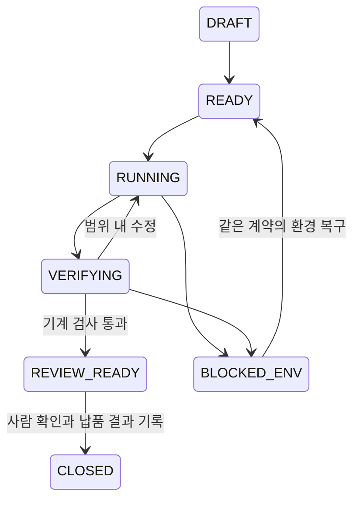
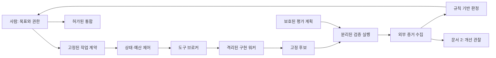

# Unity 중심 AI 게임 개발 워크플로우 시스템 구축 설계서

문서 ID: GAME-WORKFLOW-01 · 버전: 2.0 · 수정일: 2026-10-16

연결: [시스템 개선 설계서](02_safe_self_improving_ai_workflow_v2.md) · [활용·구축 가이드](03_workflow_build_guide.html)

**첫 목표는 기존 Unity 프로젝트에서 작은 기능 하나를 구현하고, 테스트·플레이어 빌드·사람의 플레이 확인까지 재현하는 것이다.** Codex로 시작하는 최소 MVP와 별도 실행 서비스를 만드는 장기 설계를 구분한다. AI는 합의한 범위 안에서 계속 구현·시험·수정하고, 사람은 게임 방향·범위 확대·권한·통합·출시를 결정한다.

이 문서는 설계 명세다. 실제 Unity 프로젝트, 검증 실행기, 접근 제어, 자동화 서비스가 구축되었다는 보고가 아니다. 예산·표본·운영 기준의 숫자는 명시된 계산 예 또는 제안값이며, 실행 권한이나 지출 승인을 부여하지 않는다. v1.0의 장기 구조는 보존하되 초기 필수 범위에서 분리했다. 이 문서의 각 G 항목은 하나의 설계 결정이고, 그 안의 세부 규칙은 해당 결정의 실행 명세다.

## 1. 목표와 수정 사항 — G01

우선순위는 ① 플레이할 가치가 있는 게임 ② 같은 품질에 드는 사람 시간과 총비용 감소 ③ 반복 가능한 개발 시스템이다. 코드량, 에이전트 수, 자율 실행 비율은 성과 지표가 아니다.

| v1.0의 문제 | v2.0의 결정 |
|---|---|
| 별도 브로커·격리 계정·DB·서명·평가 서비스를 모두 MVP로 제시 | A부는 Codex와 프로젝트 검증 절차, B부는 서비스 확장 설계 |
| `BLOCKED_ENV → READY`가 규범 전이표에 없음 | G05의 단일 전이 목록에 복구 가드까지 정의 |
| 통합 base 변경 시 같은 계약으로 `INTEGRATING → READY` 회귀 | 통합을 별도 기록으로 분리. base 변경은 `STALE`, 새 계약·새 run·재검증으로 처리 |
| 폴더·저장소·lock 파일을 보안 경계처럼 읽을 여지 | 정리·버전 식별·접근 통제의 역할을 구분하고 실제 쓰기 시험 요구 |
| 작은 표본의 실용적 개선과 통계적 입증을 같은 게이트로 처리 | G09의 운영 관찰과 문서 2 S07의 확인 실험 분리 |
| 구현 AI의 테스트 결과를 독립 검증으로 오인할 여지 | 검증 기준 소유권, 후보 내용, 실행 출처, 증거 쓰기 권한을 각각 명시 |

**주장:** 첫 구현 범위는 게임 기능 하나를 검증하여 전달하는 반복 절차다.

**자기 반박:** 플랫폼을 먼저 만들면 이후 여러 게임에서 재사용할 수 있다.

**실패 시나리오:** 몇 주간 시스템만 만들고 플레이 가능한 결과가 나오지 않는다.

**대안:** 수작업 제작, 또는 완전한 에이전트 플랫폼 선행 구축.

**최종 판단:** 게임 결과를 먼저 낸다. 장기 투자는 관찰된 반복 손실과 필요 권한이 설명될 때 진행한다.

# A. 지금 시작할 Codex 최소 MVP

## 2. 구성과 저장소 배치 — G02

최소 구성은 **사람 1명 + 기존 Codex + 기존 Unity 프로젝트 + 프로젝트 검증 스크립트 + 실행 기록**이다. 아래 경로는 배치 예시이며 이 문서가 폴더나 저장소를 생성한 것은 아니다.

```text
C:/GameWork/                         중립적인 상위 폴더; 통째로 AI 쓰기 허용하지 않음
  game-project/                     게임 저장소, Codex의 주 작업 폴더
    AGENTS.md                       짧은 프로젝트 규칙과 문서 경로
    Assets/ Packages/ ProjectSettings/
    .agents/skills/verify-my-game/SKILL.md
    scripts/verify-unity.ps1         프로젝트에 맞춰 구현·검증할 진입점
    tasks/<task-id>/contract.json
    runs/<run-id>/                   로그·결과; 비밀정보 제외, Git 포함 여부 별도 결정
    workflow.lock.json              직접 정의하는 버전 기록; Codex 내장 기능 아님
    docs/design/                    두 설계서와 가이드의 사본
  workflow-lab/                     개선 작업을 시작할 때 만드는 별도 저장소
    AGENTS.md
    skill-src/                      아직 활성화하지 않은 후보 스킬
    scripts/ tests/ evals/public/
    proposals/ experiments/ releases/
    docs/design/
C:/WorkflowControl/                 장기 보호 영역 예시; 실제 ACL/계정 분리 필요
  policy/ verifier/ acceptance/ releases/ evidence/
```

두 저장소는 변경 이력과 책임을 구분한다. 같은 계정이 양쪽에 쓸 수 있으면 보안상 분리된 것은 아니다. 별도 제어 폴더도 이름만으로 보호되지 않는다. 초기에는 검토자가 보관한 기준본과 수동 확인으로 실수를 줄이고, 무인 운영 전에는 실행 계정의 실제 쓰기·네트워크·도구 권한을 시험한다.

Codex의 프로젝트 규칙은 `AGENTS.md`에 짧게 두고 상세 명세는 필요할 때 읽게 한다. 공식 문서의 기본 프로젝트 지침 합산 한도는 32 KiB이므로 두 설계서 전체를 지침 파일에 복사하지 않는다. [AGENTS.md 공식 설명](https://learn.chatgpt.com/docs/agent-configuration/agents-md)

프로젝트 스킬은 `.agents/skills/<name>/SKILL.md`에 두며 이름·설명과 절차를 작성한다. 개발 중인 `workflow-lab/skill-src`를 활성 스킬에 symlink로 연결하지 않는다. 검토된 버전을 복사하고 교체 시점을 기록한다. [스킬 공식 설명](https://learn.chatgpt.com/docs/build-skills)

현재 ChatGPT 프로젝트의 동기화된 `sources/`는 읽기 전용 참고 자료다. 실제 Unity 저장소의 작업 폴더를 따로 열어 구축한다. 추가 폴더에 대한 쓰기 허용은 작업상 꼭 필요한 범위로 한정한다.

**주장:** 게임 저장소와 개선 저장소를 형제 관계로 두고, 시작은 게임 저장소 하나에서 한다.

**자기 반박:** 저장소가 늘면 버전 조합과 문서 갱신 비용이 생긴다.

**실패 시나리오:** 상위 폴더 전체에 쓰기 권한을 주어 개선 후보가 운영 스킬까지 바꾼다.

**대안:** 초기 단일 저장소에서 소유 경로를 나누거나, 처음부터 모든 구성 요소를 별도 저장소로 나눈다.

**최종 판단:** 두 저장소는 유지보수 경계로 채택한다. 정책·평가·증거 보호는 실제 실행 권한으로 별도 검증한다.

## 3. 최소 MVP 구축 순서와 완료 기준 — G03

기간을 보장하지 않는다. 각 단계의 산출물과 종료 조건으로 진행한다. 사용 가능한 도구·Unity 버전·기존 테스트를 먼저 확인하고 새 의존성은 필요성과 대안을 설명한 뒤 승인받는다.

| 단계 | 사용자가 정할 것 | Codex가 수행할 것 | 다음 단계로 가는 증거 |
|---|---|---|---|
| M0 기준선 | 프로젝트·타깃 플랫폼·작은 기능 후보 | 기존 변경, Editor/패키지, 테스트·빌드 진입점 읽기 | 변경 전 테스트·빌드 결과와 기존 실패 목록 |
| M1 검증 절차 | 필수 게이트와 성공 의미 | 기존 도구를 재사용해 `verify-unity.ps1` 작성 또는 보완 | 정상 실행과 의도적 실패를 구별한 기록 |
| M2 한 작업 | 목표·허용 경로·수용 조건·시간/수정 상한 | 계약 안에서 구현→시험→수정 반복 | 고정 후보, 필수 게이트, 실행 가능한 플레이어 |
| M3 사람 확인 | 조작감·재미·의도 일치 | 증거·변경·미해결 사항 정리 | 사람이 플레이한 결과, 납품 또는 승인된 통합 기록 |
| M4 관찰 축적 | 개선에 쓸 시간·비용 상한 | 다음 5~10개 실제 작업의 비용·시간·재작업 기록 | 문서 2에서 조사할 반복 병목 하나 |

M0에서 기존 테스트가 실패하면 그 사실을 보존한다. 기존 실패를 숨기거나 자동으로 합격 기준에서 제외하지 않는다. 수리 작업을 별도 계약으로 만들거나, 영향을 설명한 명시적 기준선을 정한다. M2 작업에 영향을 주는 필수 게이트 실패는 납품 합격으로 처리하지 않는다.

처음 만들 파일은 짧은 `AGENTS.md`, 작업 계약, 검증 스크립트, 검증 스킬, 실행 보고서다. 버전 조합을 관리하기 시작할 때 `workflow.lock.json`을 추가한다. 스킬 파일 쓰기가 환경에서 제한되면 사람이 검토본을 설치하거나 허용된 절차를 사용한다. 보호 경로를 우회해 설치하지 않는다.

초기 비목표: 자체 모델 API 오케스트레이터, 다중 에이전트 서비스, 자동 merge/push, 무인 배포, 비공개 평가 서버, 자동 자기개선 스케줄, 서명 서비스, Watchdog. 이 중 필요해진 것은 B부의 진입 조건으로 추가한다.

MVP의 성공은 **기능 하나의 변경 전후를 비교하고, 의도한 실패를 검출하는 검증 절차로 빌드·플레이까지 확인한 것**이다. 5~10건 관찰은 병목 발견용이며 생산성 향상의 통계적 입증이 아니다.

**주장:** 최소 MVP는 기존 Codex를 활용한 감독하의 반복 개발 절차로 충분하다.

**자기 반박:** 사람이 마지막 검증을 수행하면 자동화 수준이 낮다.

**실패 시나리오:** 검증 스크립트가 종료 코드 0만 보고 빈 결과를 통과시키거나, 문서만 작성하고 시스템 완성으로 선언한다.

**대안:** 모든 실행을 수동으로 하거나 전용 실행 엔진부터 만든다.

**최종 판단:** 반복 구현은 AI에 맡기되 검증 절차의 신뢰부터 확인한다. 구축 완료와 효율 입증을 별도로 보고한다.

## 4. 작업 계약·보고서·버전 데이터 — G04

이 문서가 공통 데이터의 원본이다. 문서 2는 의미를 바꾸지 않고 재사용한다. MVP는 JSON 파일과 사람이 확인하는 원장으로 시작한다. 자동 실행기로 전환할 때 strict schema, 범위 검사, 상태 검사를 먼저 구현한다.

### 4.1 공통 규칙

| 항목 | 규칙 |
|---|---|
| 버전 | `schema_version: "2.0"`; 미지원 버전과 알 수 없는 필드를 거부. 확장 필드는 명시적 schema 필요 |
| ID·시간 | 프로젝트 안에서 유일한 ID, UTC RFC 3339 시각 |
| digest | `sha256:`와 소문자 16진수 64자리; 저장된 정확한 바이트 기준. 자기 digest는 envelope에 저장 |
| Git OID | 저장소 형식에 맞는 전체 OID. OID만으로 미커밋·새 파일을 표현하지 않음 |
| 비용 | 정수 micro-USD. `measured`, `estimated`, `unavailable`을 구별. 모르는 비용은 0이 아님 |
| 경로 | 루트 상대 경로. 정규화 후 경계·대소문자·symlink/junction 탈출 검사 |
| 예제 | `example_only: true`는 실제 실행 거부. 예제 ID·해시·예산을 실운영 값으로 오인하지 않음 |
| 결과 | `PASS`, `FAIL`, `INCONCLUSIVE`, `BLOCKED_ENV`; 결과와 작업 상태는 별개 |

### 4.2 TaskContract 예시

아래 40자리 OID와 digest는 형식 설명용이다. `base_manifest_digest`는 작업 시작 시점의 미커밋 변경·새 파일을 포함한 내용 목록을 참조한다. 기존 사용자 변경은 별도 목록으로 보존하고 이번 작업 소유 변경과 구분한다.

```json
{
  "schema_version": "2.0",
  "example_only": true,
  "contract_id": "dash-001-r1",
  "project_id": "game-project",
  "objective": "지상에서 대시하고 재사용 대기시간 1초를 지킨다",
  "non_goals": ["공중 대시", "저장 형식 변경", "외부 출시"],
  "base_oid": "aaaaaaaaaaaaaaaaaaaaaaaaaaaaaaaaaaaaaaaa",
  "base_manifest_digest": "sha256:aaaaaaaaaaaaaaaaaaaaaaaaaaaaaaaaaaaaaaaaaaaaaaaaaaaaaaaaaaaaaaaa",
  "workflow_release_id": "supervised-local-001",
  "environment_id": "existing-unity-windows-001",
  "assurance_level": "supervised_local",
  "allowed_write": [
    "Assets/Game/Player/DashController.cs",
    "Assets/Tests/Development/DashControllerTests.cs"
  ],
  "protected_write": ["Packages/**", "ProjectSettings/**", "Assets/Tests/Acceptance/**", "scripts/verify-unity.ps1", ".agents/**"],
  "acceptance": [
    {"id": "AC1", "expectation": "지상 입력 1회가 대시 1회를 발생시킨다", "check_ids": ["dash-grounded"]},
    {"id": "AC2", "expectation": "1초 안의 추가 입력이 재실행되지 않는다", "check_ids": ["dash-cooldown"]},
    {"id": "AC3", "expectation": "공중 입력이 대시를 발생시키지 않는다", "check_ids": ["dash-airborne"]}
  ],
  "required_gates": ["scope", "compile", "editmode", "playmode", "player_build", "player_smoke"],
  "human_playtest_required": true,
  "risk_class": "R1",
  "git_permissions": [],
  "limits": {"max_wall_minutes": 90, "max_repair_rounds": 2, "max_infra_retries": 2},
  "cost_cap_micro_usd": null,
  "cost_control": "manual_review_before_paid_external_calls"
}
```

이는 기존 파일 두 개를 수정하는 예다. 새 Unity 에셋·스크립트를 만들면 해당 `.meta`도 허용 범위에 넣는다. `null` 비용 상한은 무제한 API 지출 허가가 아니다. 별도 과금 호출 전 상한을 정하거나 중단한다. 구독형 Codex 사용량을 근거 없이 API 달러 비용으로 환산하지 않는다.

계약 변경은 기존 바이트를 고치지 않고 revision과 ID를 새로 만든다. 실행 시작 후 base·목표·허용 경로·수용 기준을 바꾸면 새 run으로 연결한다. 환경 장애 복구가 단순 재시작인지, 새 Editor/패키지 도입인지 구별한다.

### 4.3 결과 레코드

| 타입 | 필수 내용 | 무효 조건 |
|---|---|---|
| `ResolvedContract` | 계약 digest, 실제 루트, 환경 manifest, 검증 계획/버전, 권한 범위 | 경로·환경·계약을 확정할 수 없음 |
| `ChangeSet` | 시작 manifest, 후보 manifest, 변경/추가/삭제/바이너리 목록, 사용자 변경 분리 | 허용 범위 밖 누적 변경 |
| `VerificationReport` | run/후보/계약/검증기/계획 digest, 시작·종료, gate별 결과와 원시 증거, 신뢰 수준 | 후보가 바뀌거나 필수 증거가 없음 |
| `RunEpisode` | 상태·종료 이유, 시도/실패/재시도, 비용 상태, 사람 활동 시간, 경과 시간, 후속 결함 | 실패 또는 비용 누락, 분모 식별 불가 |
| `HumanPlaytestReport` | 플레이한 빌드 digest, 시나리오, 관찰, 수용/재작업 판단 | 다른 빌드를 평가하거나 의견을 자동 사실로 변환 |
| `ApprovalRecord` | 주체, 정확한 행위·후보·대상·유효기간·조건, 승인 근거 | 다른 대상, 만료, base 변경, 필요한 권한 없음 |

`VerificationReport`의 gate 항목은 `{gate_id, result, expected_case_ids, observed_case_ids, evidence_refs, reason}`를 갖는다. 보고서 전체 `PASS`는 필수 gate가 모두 `PASS`이고 요구된 사람 확인도 완료한 경우에만 최종 납품 판정으로 사용할 수 있다. 기계 검사만 통과했다면 `REVIEW_READY`로 표시하고 사람 확인은 `pending`으로 남긴다.

실행 시작/완료 시 `workflow.lock.json`의 기대 버전과 실제 활성 스킬·검증기·패키지·환경의 digest를 비교한다. 불일치하면 기존 검증 결과로 진행하지 않는다. lock과 검증기 둘 다 후보가 수정할 수 있으면 이 검사는 실수 탐지 수준이다. 강한 무결성 주장은 보호된 기대값과 별도 실행 경계가 있을 때만 한다.

**주장:** 작업 범위와 검증 증거를 정확한 후보 내용에 묶는다.

**자기 반박:** JSON과 해시를 기록해도 거짓 관찰을 기록하면 신뢰할 수 없다.

**실패 시나리오:** 테스트 이후 코드가 바뀌거나 사용자가 만든 미커밋 파일을 AI 결과로 덮어쓴다.

**대안:** 대화 요약만 저장하거나 모든 실행을 커밋으로 고정한다. 후자는 Git 권한이 따로 필요하다.

**최종 판단:** 커밋 없이도 내용 manifest로 시작할 수 있다. 데이터의 동일성과 검증자의 신뢰를 별개로 관리한다.

## 5. 작업 상태 머신 — G05

MVP에서는 아래 상태를 보고서에 기록하고 사람이 전이 근거를 확인한다. B부에서 이를 자동 엔진으로 옮긴다. **아래 JSON의 `transitions`가 허용 목록의 유일한 원본**이다. 목록에 없는 전이는 거부한다. `guards`는 바로 아래 규칙이며, 상태 변경이 없는 로그 이벤트는 별도로 기록한다.

<!-- machine:game-task-v2 -->
```json
{
  "machine_id": "game-task-v2",
  "initial": "DRAFT",
  "terminals": ["CLOSED", "FAILED", "CANCELLED"],
  "transitions": [
    ["DRAFT", "READY", "prepared"],
    ["DRAFT", "CANCELLED", "cancel_settled"],
    ["READY", "RUNNING", "start"],
    ["READY", "BLOCKED_ENV", "environment_block"],
    ["READY", "FAILED", "hard_stop"],
    ["READY", "CANCELLED", "cancel_settled"],
    ["RUNNING", "VERIFYING", "freeze"],
    ["RUNNING", "BLOCKED_ENV", "environment_block"],
    ["RUNNING", "FAILED", "hard_stop"],
    ["RUNNING", "CANCELLED", "cancel_settled"],
    ["VERIFYING", "RUNNING", "repair"],
    ["VERIFYING", "REVIEW_READY", "machine_pass"],
    ["VERIFYING", "BLOCKED_ENV", "environment_block"],
    ["VERIFYING", "FAILED", "hard_stop"],
    ["VERIFYING", "CANCELLED", "cancel_settled"],
    ["BLOCKED_ENV", "READY", "environment_restored"],
    ["BLOCKED_ENV", "FAILED", "hard_stop"],
    ["BLOCKED_ENV", "CANCELLED", "cancel_settled"],
    ["REVIEW_READY", "RUNNING", "scoped_rework"],
    ["REVIEW_READY", "CLOSED", "close"],
    ["REVIEW_READY", "FAILED", "hard_stop"],
    ["REVIEW_READY", "CANCELLED", "cancel_settled"]
  ]
}
```

| guard | 필수 조건과 처리 |
|---|---|
| `prepared` | 계약·환경·기존 권한·필수 검사 목록 확정. 예제 계약, 미지원 버전, 누락 필드 거부 |
| `start` | 취소 요청 없음, 예산·시간 잔여, 작업 폴더 단일 writer 확보. 환경과 활성 버전 재확인 |
| `freeze` | 누적 변경 범위 검사 후 후보 내용 고정. 후보와 다른 로그·이전 검증 결과 사용 금지 |
| `repair` | 계약 안의 제품 결함이고 수정 횟수·총한도 잔여. 횟수를 먼저 증가시키고 기존 검증을 무효화 |
| `machine_pass` | 모든 필수 기계 gate 통과. 사람 플레이 확인이 남으면 보고서에 `pending` 표시 |
| `environment_block` | 라이선스·실행기·디스크 등 환경 원인을 증거로 확인. 새 실행 정지, 원인·재개 조건 기록 |
| `environment_restored` | 원래 계약·허용 환경·권한 유지, 취소 요청 없음, 남은 총한도 확인. 이전 PASS 재사용 없이 실행부터 다시 진행 |
| `hard_stop` | 정책 위반·한도 소진·계약 내 해결 불가 또는 평가 불확실성. 진행 중 작업과 비용을 정리한 뒤 종료 |
| `scoped_rework` | 사람의 재작업 요청이 기존 범위 안이고 수정 상한 잔여. 진행 중이거나 결과가 불명확한 통합이 없어야 함. 기존 후보·검증·승인을 무효화하고 횟수 증가 |
| `close` | 사람 확인과 전달 결과 확정. `DELIVERED_UNMERGED`, `INTEGRATED`, `DECLINED`, `STALE_SUPERSEDED` 중 하나 기록. 뒤의 두 결과는 성공 납품이 아님 |
| `cancel_settled` | 취소 요청 기록, 새 도구 실행 차단, 자식 프로세스 정지·외부 효과 확인·비용 정산 완료 |

모든 실행 시작·재개·검증 통과·납품 성공 전이에는 공통으로 `stop_requested=false`, 현재 계약/후보 일치, 유효한 실행 소유권이 필요하다. 자동 통합이 진행 중이면 재작업과 대상 내용 교체를 막고 G12의 조정을 먼저 완료한다.

취소 요청은 먼저 단조 증가하는 `stop_requested` 플래그와 이벤트로 기록한다. 프로세스나 외부 효과가 불명확하면 현재 상태에서 조정하고 `CANCELLED`로 성급하게 종료하지 않는다. 늦게 온 결과는 보존하되 승격에 사용하지 않는다. 이미 통합한 Git 변경을 취소의 일부로 자동 되돌리지 않는다.

`INCONCLUSIVE`는 PASS가 아니다. 확인된 환경 문제라면 `BLOCKED_ENV`; 오라클·요구 정의 문제라면 `FAILED`와 원인을 기록하고 수정된 계약으로 새 run을 만든다. 환경 복구 중 Editor/패키지/요구 기준이 달라졌어도 새 run이 필요하다. 종료 상태는 다시 열지 않고 `supersedes_run_id`로 후속 run을 연결한다.

아래는 읽기 쉬운 **주요 흐름만** 표시한 그림이다. 취소·실패 경로의 전체 규칙은 위 목록을 따른다.



**주장:** 작업 재시작과 실패 처리를 명시적 전이로 제한한다.

**자기 반박:** 상태가 많아지면 제어 코드 자체가 새로운 오류 원인이 된다.

**실패 시나리오:** 환경 복구 경로를 빠뜨리거나 취소된 작업의 늦은 성공 결과를 받아 납품한다.

**대안:** 대화로만 진행 상태를 관리하거나 처음부터 분산 상태 엔진을 구축한다.

**최종 판단:** MVP는 작은 상태 기록으로 시작한다. 전이 목록과 가드의 의미를 고정한 뒤 자동화하며, 내용이 달라지는 재시작은 새 계약·run으로 남긴다.

## 6. Unity 테스트·빌드·플레이 검증 — G06

먼저 `ProjectSettings/ProjectVersion.txt`, `Packages/manifest.json`, `Packages/packages-lock.json`, 기존 CI와 테스트 설정을 읽는다. 기존 Editor의 정확한 버전, 빌드 모듈, 플랫폼, scripting backend, 씬 목록, 그래픽 환경을 기록한다. 아래 공식 참조의 Unity 6.0/Test Framework 1.4를 현재 프로젝트에 설치하거나 업그레이드하라는 의미는 아니다.

| gate | 필수 관찰 | 실패 또는 미완료 조건 |
|---|---|---|
| scope | 후보 manifest와 허용 변경 목록 비교 | 보호 경로 변경, 누락된 신규·삭제·바이너리 파일 |
| compile | 현재 후보에서 컴파일 완료 | 에러, timeout, 다른 후보의 오래된 결과 |
| editmode | 예상 테스트 ID·개수와 실제 XML 비교 | XML 없음, 0개, 필수 case 누락/skip, 실패 |
| playmode | 실제 프레임·입력·씬 동작 관찰 | 종료 코드만 존재, 필요한 그래픽 환경 없음 |
| player_build | BuildReport 성공과 실제 산출물 확인 | 실패 보고, 산출물 없음, 잘못된 target/scene |
| player_smoke | 빌드 실행→필수 씬 진입→핵심 동작→정상 종료 | 실행 불가, crash, timeout, 검증하지 않은 동작 |
| human_playtest | 동일 빌드를 사람이 플레이 | 조작감·의도 확인 미완료; 자동 재미 점수로 대체 불가 |

`verify-unity.ps1`은 이 프로젝트에서 만들 진입점 이름이다. Codex나 Unity가 기본 제공하는 명령이 아니다. 검증 스킬은 스크립트의 입력, 실행 전 조건, 보고서 위치, 실패 처리만 안내하고 합격 기준을 새로 해석하지 않는다.

검증 스크립트의 처리 순서:

1. 계약·후보·환경·검증기 버전 확인. 실행마다 빈 결과 폴더와 유일한 nonce 생성.
2. 해당 복제본을 사용하는 다른 Editor가 없는지 확인. 같은 프로젝트 경로에 동시 Editor/batch 실행 금지.
3. 제한 시간 안에서 compile, EditMode, PlayMode, build, smoke를 실행. timeout을 별도 결과로 기록.
4. 종료 코드, 원시 로그, XML의 실제 case 집합, BuildReport, 플레이어 산출물을 함께 검사.
5. 결과 파일의 생성 시각만 믿지 않고 이번 실행 nonce·후보 manifest·실행기 기록과 연결.
6. 실행 후 후보와 검증기 내용이 바뀌었는지 다시 확인. 바뀌면 증거를 무효화.
7. 기계 검사 결과와 사람 확인을 분리한 보고서 작성. 필요한 증거가 없으면 PASS 금지.

실행 인자는 문자열을 이어 붙인 shell 명령보다 인자 배열로 넘긴다. 아래는 프로젝트 경로를 확정한 뒤 어댑터가 구성할 예시다.

```json
{
  "example_only": true,
  "editmode_args": ["-batchmode", "-projectPath", "<PROJECT_COPY>", "-runTests", "-testPlatform", "EditMode", "-testResults", "<RUN_DIR>/editmode.xml", "-logFile", "<RUN_DIR>/editmode.log"],
  "playmode_args": ["-batchmode", "-projectPath", "<PROJECT_COPY>", "-runTests", "-testPlatform", "PlayMode", "-testResults", "<RUN_DIR>/playmode.xml", "-logFile", "<RUN_DIR>/playmode.log"]
}
```

테스트 명령에 `-quit`를 함께 사용하면 테스트가 끝나기 전에 종료될 수 있으므로 위 예에는 넣지 않는다. `-nographics`는 그래픽 장치 초기화를 생략하므로 그래픽 검증에 사용하지 않는다. 실제 옵션과 결과 형식은 설치된 버전으로 확인한다. [Unity 명령줄](https://docs.unity3d.com/6000.0/Documentation/Manual/EditorCommandLineArguments.html), [Test Framework 명령줄](https://docs.unity3d.com/Packages/com.unity.test-framework@1.4/manual/reference-command-line.html)

빌드는 기존 프로젝트의 Editor 빌드 메서드를 우선 재사용한다. 없으면 별도 계약으로 `BuildPipeline.BuildPlayer`를 호출하고 `BuildReport.summary.result`와 산출물을 검사하는 메서드를 작성한다. 예전 문서의 `WorkflowCI.Build.Player`는 구현해야 하는 사용자 정의 메서드이며 내장 API가 아니다. [BuildPlayer API](https://docs.unity3d.com/6000.0/Documentation/ScriptReference/BuildPipeline.BuildPlayer.html)

개발용 테스트는 AI가 추가해도 되지만, 기존 수용 테스트·의무 case 목록·합격 기준은 기능 후보가 임의로 바꾸지 못하게 한다. 테스트 변경이 필요하면 원인을 제시하고 별도 검토한다. 실패 후 반복 실행은 진단이며 첫 실패를 삭제하거나 성공한 재시도만 대표 결과로 고르지 않는다.

MVP의 마지막 확인은 사람이 기준 검증본을 확인하고 고정된 후보를 다시 실행하는 방식이다. 이는 실수와 누락을 줄이지만, 같은 OS 계정에서 실행한 후보 C#이 검증 환경을 조작하지 못한다는 보장은 아니다. 그런 위험까지 다룰 무인 운영에는 G11의 격리와 외부 관찰이 필요하다.

**주장:** 컴파일·테스트·빌드·플레이는 서로 다른 증거이며 모두 필요한 범위에서 확인한다.

**자기 반박:** 작은 코드 수정에도 전체 검증을 반복하면 느리다.

**실패 시나리오:** 테스트는 통과하지만 Player에서 입력이 안 되거나, 오래된 XML을 읽고 성공으로 표시한다.

**대안:** 모든 검사를 매 수정마다 실행하거나 마지막 빌드 하나만 검사한다.

**최종 판단:** 수정 중에는 빠른 관련 검사를 쓰고 납품 후보에는 계약의 필수 검사를 모두 실행한다. 게이트 축소는 별도 근거와 검토를 요구한다.

## 7. 자율 실행과 사람 승인 경계 — G07

| 범위 | 처리 |
|---|---|
| 계약 안의 읽기·허용 코드 수정·로컬 시험·수정 반복 | 이미 받은 허가와 실행 환경 안에서 연속 수행 |
| 허용 경로·게임 목표·예산 확대, 새 의존성, 저장 호환성·패키지·Editor 변경 | 영향·대안·복구 방법을 준비한 뒤 추가 승인 |
| 정책·평가기·수용 기준·활성 스킬·검증기 변경 | 별도 개선 계약과 검토; 기능 구현 중 임의 수정 금지 |
| Git stage/commit/amend/reset/rebase/push, 최종 통합 | 사용자 지침에 따라 정확한 행위의 명시적 허가 필요 |
| 외부 업로드·출시·결제·실데이터 변경 | 대상과 산출물을 확정한 승인 필요 |

같은 권한을 매 도구 호출마다 반복해서 묻지 않는다. 승인 대상은 후보 내용, 대상 환경, 정확한 행위, 잔여 위험, 비용 상한, 복구 계획이 검토 가능해진 상태로 제시한다. 침묵·시간 경과·자동 선택은 승인이 아니다.

Codex의 sandbox는 실행 권한, approval policy는 추가 허용이 필요한 시점을 관리한다. 자동 승인 검토가 위험한 작업을 통과시켰다고 게임 출시나 제품 정책 변경을 사람이 승인한 것은 아니다. 명령 실행용 네트워크 제어가 앱·MCP·브라우저의 모든 연결을 대신하지도 않는다. 사용하는 도구 경로별 권한을 따로 확인한다. [Codex 승인·보안 공식 설명](https://learn.chatgpt.com/docs/agent-approvals-security)

위험도는 `R0` 조회·문서, `R1` 제한된 기능 변경, `R2` 공유 구조·환경·검증 체계, `R3` 권한·비밀·공개 출시·되돌리기 어려운 효과로 분류한다. 낮은 위험 분류가 Git 권한이나 외부 지출 권한을 자동으로 부여하지 않는다.

**주장:** 사람 승인은 의미 있는 결정에 집중하고 구현 루프를 불필요하게 끊지 않는다.

**자기 반박:** 작은 허용 변경 여러 개가 합쳐져 큰 영향을 만들 수 있다.

**실패 시나리오:** “빌드해 달라”를 “외부에 배포해도 된다”로 해석한다.

**대안:** 매 호출 승인 또는 작업 전체에 포괄적 권한 부여.

**최종 판단:** 개별 도구 요청과 누적 변경을 함께 본다. 기존 허가는 존중하되 효과와 대상이 달라지면 다시 판단한다.

## 8. Git·Unity 에셋·활성 버전 관리 — G08

작업 전 기존 변경과 새 파일을 기록한다. 사용자의 변경을 되돌려 깨끗한 상태를 만들지 않는다. 격리 복제본이나 worktree가 필요하면 기존 미커밋 변경을 어떻게 보존·반영할지 먼저 정한다. worktree는 작업 분리 수단이며 프로세스의 접근 권한을 제한하는 보안 장치로 간주하지 않는다. [Git worktree](https://git-scm.com/docs/git-worktree)

Unity `.meta`는 에셋과 함께 관리한다. 이동 시 GUID를 보존하고 씬/프리팹 동시 쓰기를 피한다. 기존 serialization·LFS·merge 규칙을 존중한다. `Library`, `Temp`, `Logs`를 다른 실행과 공유하지 않는다. 새 에셋의 출처·사용 조건을 기록한다. [Unity 에셋 메타데이터](https://docs.unity3d.com/6000.0/Documentation/Manual/AssetMetadata.html)

`workflow.lock.json`에는 최소한 `workflow_release_id`, 활성 스킬·검증 스크립트·검증 계획의 digest, 환경 manifest ID를 기록한다. 이것은 직접 만들 계약이며 Codex가 자동으로 강제하는 설정이 아니다. 스크립트가 실제 파일과 비교하고 사람이 기대값을 확인해야 의미가 생긴다.

검증된 개선 후보를 도입할 때는 문서 2의 승인된 release에서 파일을 복사한다. 진행 중인 작업은 기존 버전을 유지하고 다음 작업부터 새 버전을 적용한다. 파일 교체만으로 실제로 어떤 지침이 로드됐는지 확실하지 않으면 새 작업에서 선택된 버전과 경로를 재확인한다.

**주장:** 검증된 게임 후보와 검증된 워크플로우 버전을 각각 고정한다.

**자기 반박:** 버전 기록만 늘리고 실제 실행에서는 최신 파일을 읽을 수 있다.

**실패 시나리오:** 개선 저장소의 스킬을 바로 연결해 실행 도중 규칙이 바뀌거나 `.meta`를 잃어 참조가 깨진다.

**대안:** 항상 최신 파일 사용 또는 매 작업 완전한 환경 복제.

**최종 판단:** 초기에는 검토된 복사본과 실행 전후 확인을 사용한다. 자동 버전 전환은 검증·승인·복구 절차가 생긴 뒤 도입한다.

## 9. 비용·품질 측정과 MVP 벤치마크 — G09

| 지표 | 정의와 주의점 |
|---|---|
| 작업 수용률 | 정해진 관찰 마감까지 수용된 작업 수 / 시작된 계약 수. 실패·취소·환경 중단 포함; 원인별 수치를 함께 표시 |
| 수용 작업당 비용 | 모든 시작 작업의 비용 합 / 수용 작업 수. 실패·재시도 포함. 수용 0이면 무한대 또는 계산 불가로 표시 |
| 사람 활동 시간 | 지시·검토·플레이·오류 복구에 실제 쓴 시간. AI 대기 시간과 분리 |
| 경과 시간 | 실행 시작부터 계약에 정한 전달 시점까지. 환경 대기 포함/제외를 둘 다 표시 가능하나 정의 고정 |
| 후속 품질 | 동일한 관찰 창의 결함·재개방·빌드 실패. 예: 납품 후 7일; 아직 7일 안 된 작업은 관찰 중 |
| 권한·증거 사고 | 실제 위반, 차단된 시도, 누락 증거를 구분. 0건 관측이 위험 0%의 증명은 아님 |
| 게임 가치 | 플레이 목표 달성·조작감·재플레이 의향과 구체적 관찰. 자동 합성 점수 하나로 대체하지 않음 |

첫 5~10건은 시간 기록 방식과 병목을 찾는 관찰이다. 기존 방식과 후보 방식의 탐색 비교가 필요하면 같은 과제 계열을 짝지어 실행하고 순서를 무작위 또는 균형 배치한다. 과제 난도·변경 유형·환경을 기록한다. 동일 버그 변형과 같은 과제 재시도는 독립 표본으로 늘려 세지 않는다.

관찰 종료 시 실패를 제외해 비율을 높이지 않는다. 진행 중인 작업은 관찰 중으로 표시하고 분모·마감 시점을 고정한다. 성공 비용만 보고하는 경우에는 전체 비용 지표를 반드시 함께 둔다. 비용이 추정치이거나 제공되지 않으면 그 상태를 표시하고 절감 입증에 사용하지 않는다.

독립적인 동일 실패 확률을 가정한 이항 예에서 30회 중 실패 0건의 단측 95% 상한은 `1 − 0.05^(1/30) ≈ 9.50%`다. 이는 실측 결과가 아니며, 의존적인 재시도 30회를 이 공식의 독립 표본으로 넣을 수 없다. 정확 이항 구간은 표본 가정을 전제로 한다. [NIST 정확 이항 구간](https://www.itl.nist.gov/div898/software/dataplot/refman2/auxillar/exacbino.htm)

정식 효과 검증은 문서 2 S07을 사용한다. v1.0의 “6개 층 × 5개 과제 + 보수적 구간 + −5%p 비열등”은 최대 가능한 하한이 약 −33.17%p여서 통과가 불가능하다. 따라서 이 조합은 기본 게이트에서 제거했다. 표본 수를 늘린다는 말만으로 해결하지 않고 사전 가능성·검정력·비용 계산을 요구한다.

**주장:** 모든 시도의 비용과 품질을 같은 분모로 관찰한다.

**자기 반박:** 작업이 이질적이고 사람 시간 측정에 오차가 많다.

**실패 시나리오:** 쉬운 성공 작업만 고르거나 반복 실행을 독립 표본으로 세어 생산성 향상을 주장한다.

**대안:** 정성 판단만 하거나 처음부터 대형 벤치마크를 운영한다.

**최종 판단:** MVP에서는 정직한 기술 통계와 재현 사례로 판단하고, 일반화된 효과 주장은 별도 사전등록 실험으로 제한한다.

## 10. 실패를 검출하는 시험과 위험 대응 — G10

MVP 구축 때 다음 시험을 검증 절차에 맞게 구현한다. 실게임·사용자 원본에 고의로 손상을 주지 않고 작은 fixture나 복제본을 사용한다.

| ID | 입력·장애 | 기대 결과 | 단계 |
|---|---|---|---|
| G-T01 | 예제/누락/미지원 계약 | 시작 거부, 이유 기록 | MVP |
| G-T02 | 허용 밖 변경·새 파일·삭제 | 범위 gate 실패 | MVP |
| G-T03 | 종료 0 + XML 없음/0개/필수 case skip | PASS 거부 | MVP |
| G-T04 | 다른 후보의 결과·오래된 build | digest/실행 식별 불일치 거부 | MVP |
| G-T05 | 후보 동결 뒤 코드 1바이트 변경 | 검증·승인 무효 | MVP |
| G-T06 | 명백한 컴파일 오류·실패 assertion | 해당 gate 실패를 실제 검출 | MVP |
| G-T07 | 빌드 성공 표시만 있고 Player 없음/실행 불가 | build/smoke 실패 | MVP |
| G-T08 | 환경 장애 후 동일 환경 복구 | `BLOCKED_ENV → READY` 허용, 새 검증 | MVP |
| G-T09 | 취소 요청 뒤 늦은 PASS | 보존만 하고 승격 금지 | MVP |
| G-T10 | 표에 없는 전이·종료 상태 재개 | 전이 거부 | MVP 명세 / 엔진 구현 시 자동 시험 |
| G-T11 | 경로 탈출·보호 파일 쓰기·MCP 경유 효과 | 실제 실행 경계에서 차단 | 무인 실행 전 |
| G-T12 | 동시 유료 요청으로 상한 초과 | 원자적 예약에서 거부 | 서비스 확장 |
| G-T13 | 통합 응답 유실·base 변경 | G12의 조정/STALE, 무조건 재실행 금지 | 자동 통합 전 |
| G-T14 | 후보가 가짜 XML/서명 요청/증거 교체 시도 | 외부 수집·권한 경계에서 탐지/차단 | 독립 검증 서비스 |

| 위험 | 대응 | 재개 조건 |
|---|---|---|
| 라이선스·패키지·빌드 모듈 없음 | 환경 차단, 자동 코드 수정 루프 중지 | 환경 준비를 확인하거나 새 환경 계약 |
| flaky 테스트 | 첫 실패 보존, 반복은 진단으로 분리 | 오라클 수리·재검토; 유리한 재시도 선택 금지 |
| 로그·웹·에셋의 지시문 | 참고 데이터로 처리, 권한 변경 근거로 사용 금지 | 원래 계약 안의 요청만 실행 |
| 검증 조작 의심 | 후보·원시 증거 보존, 납품 차단 | 독립적인 재실행과 원인 확인 |
| 비용·수정 시간 초과 | 새 요청 중지, 진행 중 비용 정리 | 새 범위·상한이 승인된 후속 계약 |
| 재미/기획 불일치 | 기능 추가 중지, 플레이 관찰 검토 | 사람이 목표를 수정한 새 계약 |

**주장:** 정상 결과를 만드는 시험과 잘못된 결과를 거부하는 시험을 함께 갖춘다.

**자기 반박:** 알려진 fixture만 통과해도 실제 실패를 모두 막는 것은 아니다.

**실패 시나리오:** 형식상 유효한 가짜 보고서를 실제 실행 성공으로 받아들인다.

**대안:** 로그를 매번 사람이 읽거나 모든 검사를 통합 테스트로만 작성한다.

**최종 판단:** 반복 가능한 음성 시험과 실제 실행 관찰을 결합하고, 문서 검사 통과와 시스템 시험 통과를 구분한다.

# B. 실제 병목이 생긴 뒤 구축할 장기 시스템

## 11. 제어·실행·검증의 분리 — G11

확장 조건은 반복 작업의 대기·수동 조정 비용이 측정되었고, 무인 실행이 필요하며, 아래 경계를 시험할 예산과 운영 책임자가 있는 경우다. 단순히 AI가 더 많은 코드를 쓸 수 있다는 이유로 확장하지 않는다.



| 구성 요소 | 구현 가능한 초기 단위 | 권한·경계 |
|---|---|---|
| 상태 제어 | 단일 프로세스와 SQLite 등 기존 기술 | 계약·상태·이벤트 원자적 기록; 워커 직접 쓰기 금지 |
| 도구 브로커 | 타입이 있는 요청·경로 검사·예산 예약 | 실행 전 권한 강제; 허용 목록과 OS/VM 격리 함께 적용 |
| 구현 워커 | 작업별 복제본·제한 계정/VM | 최소 파일·네트워크 권한, 운영키 미탑재 |
| Unity 실행기 | 고정 Editor·패키지·타깃을 가진 작업 공간 | 실행마다 분리, 리소스·timeout·프로세스 트리 관리 |
| 검증 실행기 | 고정 후보로 새로 만든 환경 | 구현 워커가 검증 계획·실행 이력·원시 증거를 덮어쓰지 못함 |
| 판정·증거 수집 | 규칙 함수와 외부 수집기 | 후보가 보내는 PASS 문자열만으로 판정하지 않음 |
| 통합 서비스 | 최소 Git 권한을 가진 별도 실행 주체 | 검증된 내용·현재 base·정확한 승인 확인 |

모델을 둘 사용한다고 검증이 독립되는 것은 아니다. 테스트 원본이 읽기 전용이어도 후보 코드가 같은 프로세스에서 돌아가면 메모리·출력·파일을 조작할 여지가 있다. 보호된 기대 결과와 원시 관찰을 별도 프로세스/서비스에 두고 가능한 동작은 Player 외부에서 관찰한다. 같은 Unity 프로세스 내부 테스트가 남는다면 그 신뢰 한계를 표시한다. 수집기 서명은 출처를 증명할 뿐, 후보가 만든 XML의 진실성을 자동으로 증명하지 않는다.

보호 경계는 테스트용 파일을 대상으로 실제 읽기/쓰기·프로세스·네트워크 요청을 시도해 확인한다. shell, Unity 실행 코드, MCP, 브라우저 등 실제로 사용하는 경로를 각각 점검한다. mock 권한 거부만으로 무인 운영을 승인하지 않는다.

상태 변경은 `expected_state_version`의 CAS와 이벤트 저장을 같은 트랜잭션에서 처리한다. 요청에는 `request_id`, `run_id`, 계약 digest, payload digest를 넣는다. 같은 요청 ID와 같은 내용은 기존 결과를 반환하고, 같은 ID와 다른 내용은 충돌로 거부한다. lease 만료는 중복 실행 허가가 아니다. 프로세스 nonce·시작 시각·외부 상태를 조회해 조정한다.

비용은 `spent + reserved + next_upper_bound <= cap`을 원자적으로 검사한다. 취소 후에도 미정산 과금 예약을 유지한다. 가격·사용량을 모르면 상한을 정하거나 실행을 멈춘다. 시간·수정 횟수·동시 실행 수에도 상한을 둔다. 기본 1개 실행에서 시작하고 병렬화는 측정된 필요가 있을 때 추가한다.

**주장:** 무인 실행의 자율성은 강제 가능한 실행·비용·증거 경계에 비례해야 한다.

**자기 반박:** 격리·운영 비용이 절감 효과보다 클 수 있고 완전한 독립 검증도 어렵다.

**실패 시나리오:** API allowlist만 믿고 임의 코드가 실행되는 워커에 호스트 자격증명을 제공한다.

**대안:** 감독하의 MVP를 계속 사용하거나 모든 작업마다 전용 VM을 만든다.

**최종 판단:** 운영 규모에 맞춰 경계를 강화한다. 검증되지 않은 권한 분리는 설계 의도로 표시하고 실제 보장으로 주장하지 않는다.

## 12. 통합 상태 머신과 base 변경 처리 — G12

Git 통합은 게임 작업 상태와 별도 `IntegrationRecord`로 관리한다. 게임 작업은 `REVIEW_READY`에서 결과를 기다린다. 자동 통합이 없는 MVP는 이 기록을 만들 필요 없이 `DELIVERED_UNMERGED`로 종료할 수 있다.

`IntegrationRecord`는 `run_id`, 검증 후보 manifest, `expected_base_oid`, 통합 대상, 허가된 Git 행위, approval digest, idempotency key, 실제 결과 OID를 갖는다. 아래 허용 목록 외의 전이는 거부한다.

<!-- machine:game-integration-v2 -->
```json
{
  "machine_id": "game-integration-v2",
  "initial": "WAITING_APPROVAL",
  "terminals": ["INTEGRATED", "STALE", "REJECTED", "FAILED"],
  "transitions": [
    ["WAITING_APPROVAL", "INTEGRATING", "authorized_current"],
    ["WAITING_APPROVAL", "STALE", "base_changed_no_effect"],
    ["WAITING_APPROVAL", "REJECTED", "declined_or_expired"],
    ["INTEGRATING", "INTEGRATED", "applied_verified"],
    ["INTEGRATING", "RECONCILING", "outcome_unknown"],
    ["INTEGRATING", "STALE", "base_changed_no_effect"],
    ["INTEGRATING", "FAILED", "failure_settled"],
    ["RECONCILING", "INTEGRATED", "applied_verified"],
    ["RECONCILING", "INTEGRATING", "provably_not_applied"],
    ["RECONCILING", "STALE", "base_changed_no_effect"],
    ["RECONCILING", "FAILED", "failure_settled"]
  ]
}
```

| guard | 필수 조건과 처리 |
|---|---|
| `authorized_current` | 정확한 후보·대상·Git 행위의 유효한 승인, 현재 base 일치. 통합 의도를 저장하고 대상 ref에 조건부 갱신 적용 |
| `base_changed_no_effect` | base가 달라졌고 이번 통합 효과가 아직 없음을 확인. 후보·승인 재사용 금지 |
| `declined_or_expired` | 명시적 거절/취소 또는 승인 만료로 실행하지 않기로 결정; 외부 효과 없음 |
| `applied_verified` | 실제 대상 이력·내용이 검증 후보 및 승인된 통합 결과와 일치. 실행 응답만으로 판단하지 않음 |
| `outcome_unknown` | timeout·응답 유실·중단 요청 등으로 결과가 불명확. 새 통합을 멈추고 실제 대상 조회 |
| `provably_not_applied` | 통합 미실행이 증명되고 base·승인·후보가 여전히 유효. 동일 작업 의도로 재시도 |
| `failure_settled` | 실패와 외부 효과가 확인·정리되었으며 자동 재시도하지 않기로 결정 |

`RECONCILING`에서 결과를 확인할 수 없으면 그 상태로 사람이 조사한다. 이미 적용된 변경을 실패로 덮어쓰거나 다시 push하지 않는다. 취소가 도착해도 이미 생긴 효과를 자동 삭제하지 않는다.

base 변경은 `STALE`로 끝낸다. 원래 게임 run은 `CLOSED / STALE_SUPERSEDED`로 닫고, 새 base의 `TaskContract`와 `run_id`를 만든다. 새 후보를 검증하고 새 내용에 대한 승인을 받는다. **`INTEGRATING → READY`는 v2.0에서 허용되지 않는다.** 이로써 불변 계약을 바꿔 같은 run을 재사용하는 모순을 없앴다.

`INTEGRATED`일 때만 원래 작업을 `CLOSED / INTEGRATED`로 닫는다. 거절·실패는 납품 성공과 구분해 원인을 기록한다. 후속 결함은 기존 성공 기록을 지우지 않고 연결된 결함·복구 계약으로 남긴다.

**주장:** 구현 작업과 외부 Git 통합의 수명주기를 분리한다.

**자기 반박:** 기록이 두 개라 운영 화면이 복잡해질 수 있다.

**실패 시나리오:** 승인 후 base가 바뀌었는데 이전 검증을 재사용하거나 응답 유실을 미실행으로 오인한다.

**대안:** 단일 상태 머신에 모든 Git 상황을 넣거나 통합을 항상 사람이 수행한다.

**최종 판단:** MVP의 수동 통합을 유지할 수 있다. 자동화할 때는 외부 효과 조정을 별도로 구현하고 검증한 뒤 사용한다.

## 13. 확장 단계·두 문서의 연결·성공 기준 — G13

| 단계 | 추가할 것 | 진입·종료 조건 |
|---|---|---|
| L1 실행 제어 | strict schema, 상태 엔진, 멱등성, 예산 예약 | 반복 조정 비용이 관측됨; 상태·재시작·예산 음성 시험 통과 |
| L2 강한 검증 | 분리 계정/VM, 외부 수집기, 보호 평가 계획 | 실제 우회/쓰기 시험과 후보 증거 조작 시험을 통과 |
| L3 제한 자동 통합 | 승인 원장, 통합 서비스, 조정 상태 | 정확한 승인·stale base·응답 유실·취소 시험 통과 |
| L4 개선 배포 연동 | 문서 2의 후보·평가·도입·복구 | 이전 버전 복구가 후보와 독립적으로 동작함을 확인 |

서비스 수·달력 일수는 성공 기준이 아니다. 각 단계에서 게임 작업의 사람 시간, 총비용, 후속 품질이 실제로 어떻게 달라졌는지 확인한다. 두 작업 주기 연속으로 게임 진척 없이 플랫폼 기능만 늘면 범위를 다시 정한다. 이는 초기 운영 정책 제안이며 변경 시 이유를 기록한다.

```text
사람의 게임 목표
  → 문서 1 TaskContract
  → 게임 후보 + VerificationReport + HumanPlaytestReport
  → RunEpisode와 비용·후속 결함
  → 문서 2 ImprovementProposal + ExperimentPlan
  → 개선 후보 + EvaluationReport + 승인된 WorkflowRelease
  → 문서 1의 다음 run에서 버전 고정
```

| 책임 | 원본 정의 | 변경 주체 |
|---|---|---|
| 작업·결과·승인 공통 타입 | 문서 1 G04 | 계약 소유자 |
| 게임 작업/통합 전이·Git 권한 | 문서 1 G05, G07, G12 | 사람 정책 소유자 |
| 게임 검증·기본 측정 | 문서 1 G06, G09 | 검증 소유자·게임 책임자 |
| 개선 후보·실험·릴리스 | 문서 2 S04 | 개선 계약 소유자 |
| 개선 상태·통계·승격·복구 | 문서 2 S05, S07~S09 | 평가 소유자·사람 승인자 |

문서가 충돌하면 실행 AI가 자신에게 유리한 쪽을 선택하지 않는다. 관련 행위를 중단하고 원본 정의와 버전을 정정한다. 기존 권한 범위를 넘어서는 해석은 허용하지 않는다.

완료 수준은 다음처럼 따로 보고한다.

1. **설계 정리:** 문서·예시·전이·계산의 일관성을 확인했다.
2. **MVP 작동:** 실제 Unity 프로젝트에서 정상/실패 사례와 기능 1개의 빌드·플레이를 확인했다.
3. **운영 가능:** 실제 권한·재시작·복구 경계를 시험했고 운영 책임자가 있다.
4. **효과 입증:** 사전 정의한 비교와 관찰을 거쳐 품질·비용·사람 시간 개선을 증명했다.

이 파일을 받았다는 사실은 2~4를 충족하지 않는다. 문서만으로 스킬·스크립트·자동 실행·Git 작업·배포가 생성되지 않는다.

**주장:** 두 시스템은 게임 결과와 검증된 다음 버전을 주고받는 별도 루프다.

**자기 반박:** 개선 루프가 커지면 시스템 자체의 지표를 최적화할 유인이 생긴다.

**실패 시나리오:** 워크플로우 비용 점수는 좋아지지만 게임 제작과 플레이 검증은 지연된다.

**대안:** 모든 개선을 중단하거나 게임과 시스템의 목적을 하나의 점수로 합친다.

**최종 판단:** 게임의 창작 목표는 사람이 유지하고 시스템 변경은 그 목표에 대한 순편익으로 평가한다. 구축 완료, 안전성 범위, 효과 입증을 구분해 운영한다.
