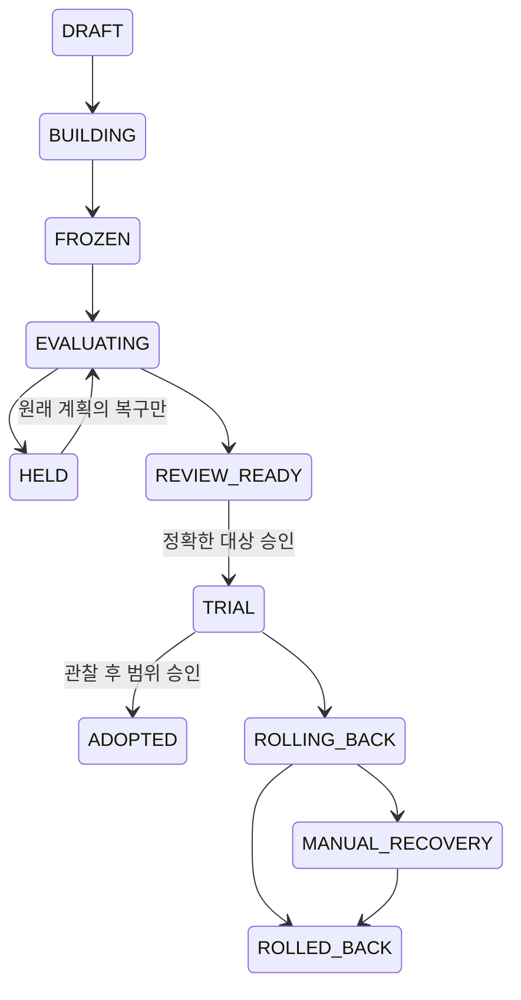
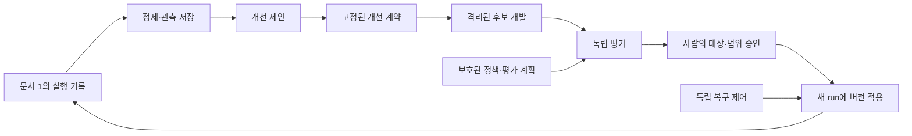

# AI가 게임 개발 시스템을 안전하게 개발·개선하는 워크플로우 설계서

문서 ID: SELF-IMPROVEMENT-02 · 버전: 2.0 · 수정일: 2026-10-16

연결: [게임 개발 시스템 설계서](01_unity_ai_game_development_workflow_v2.md) · [활용·구축 가이드](03_workflow_build_guide.html)

**처음에는 AI가 개선안을 제안하고 후보를 시험하며, 사람이 확인한 버전만 다음 게임 작업에 사용한다.** 자동 자기개선 서비스는 실제 병목과 충분한 검증·복구 능력이 생긴 뒤 구축한다. 자기개선은 코드·프롬프트·스킬·도구·작업 절차의 새 버전을 만드는 것이며, 목적·권한·합격 기준을 스스로 바꾸거나 모델 가중치를 자동 학습한다는 뜻이 아니다.

문서 1의 게임 작업 계약·상태·검증·비용 정의를 사용한다. 두 문서는 설계 명세이며 실제 실행기·권한 경계·평가 서버·자동 배포를 구현하거나 시험한 보고서가 아니다. 아래 수치와 계산 사례는 실측 성과가 아니다. 모든 S 항목은 하나의 설계 결정이며 그 안의 세부 규칙은 해당 결정의 실행 명세다.

## 1. 무엇을 바꿨고 무엇을 목표로 삼는가 — S01

| v1.0의 문제 | v2.0의 결정 |
|---|---|
| 자기개선 MVP에 독립 서비스·비공개 평가·Canary·Watchdog를 모두 요구 | A부는 수동 승인 기반 개선 루프, B부는 서비스 확장 |
| 6개 층 × 5개 과제의 보수적 구간으로 −5%p 비열등 판정 | 불가능한 조합 제거. 파일럿과 확인 실험을 나누고 S07에서 계산 가능한 새 규칙 제공 |
| 캐시를 첫 개선으로 지정 | 실제 기록에서 가장 큰 반복 손실을 먼저 선택. 캐시는 조건부 예시 |
| 모든 모델·환경 차이를 실험 무효로 해석할 여지 | `changed_factors`와 `controlled_factors`를 사전에 구분 |
| 후보·평가·릴리스·승인 간 해시 참조가 혼동될 여지 | 방향이 한쪽인 참조 사슬 고정, 승인과 배포 결과를 release 본문에서 분리 |
| 보류·취소·도입 후 실패의 전이 불명확 | S05의 단일 전이 목록과 활성화 전/후 취소 처리 구분 |

개선 목표는 게임 제작의 정확성, 사람 시간, 총비용, 재작업 감소다. 안전성 결함 수리는 생산성 절감 실험과 별도로 정당화할 수 있다. 그러나 “안전을 위해 필요했다”와 “비용을 절감했다”는 서로 다른 주장으로 기록한다.

**주장:** 시스템 개선은 더 좋은 게임을 만드는 데 도움이 될 때 가치가 있다.

**자기 반박:** 기반 기술 투자는 짧은 기간의 게임 성과만으로 평가하기 어렵다.

**실패 시나리오:** 개선 AI가 새 개선 과제를 계속 생성하고 게임 기능 작업은 진행하지 않는다.

**대안:** 사람이 모든 개선을 선택하거나 시스템 자체를 독립 연구 프로젝트로 운영한다.

**최종 판단:** 연구를 할 때도 별도 예산과 목적을 명시한다. 게임 개발용 개선은 게임 기회비용까지 포함해 평가한다.

# A. Codex로 시작하는 최소 개선 MVP

## 2. 시작 조건과 구축 순서 — S02

문서 1의 M0~M3, 즉 기존 Unity 기준선과 고정된 검증 절차로 기능 하나를 전달한 경험이 선행 조건이다. 보통 5~10개 실제 작업에서 손실을 기록한 뒤 시작한다. 중대한 검증·안전 오류가 하나 발견되었다면 표본 수를 채우려고 수리를 미루지 않는다.

| 단계 | 산출물 | 완료 조건 |
|---|---|---|
| I0 현재 버전 보존 | 활성 스킬·검증기·설정의 기준본과 버전 목록 | 이전 방식으로 다시 실행할 수 있음 |
| I1 병목 선정 | 관측 사례, 원인 가설, 반대 가설, 개선하지 않는 대안 | 실제 손실을 설명하고 작게 검증할 수 있음 |
| I2 후보 개발 | `workflow-lab`의 후보 변경과 관련 회귀 시험 | 운영 파일에 직접 반영하지 않고 정상·실패 사례 확인 |
| I3 탐색 비교 | 같은 과제 계열의 기준선/후보 기록, 비용·사람 시간 | 실패와 재시도까지 포함한 비교 보고서 |
| I4 제한 도입 | 정확한 후보·적용 작업군·기간·복구안을 승인한 기록 | 다음의 낮은 위험 게임 작업에서 사용하고 관찰 |
| I5 판단 | 제한 유지, 확대 검토, 보류 또는 복구 | 품질·실제 손실·개선 비용을 함께 평가 |

초기 한도 예시는 동시 후보 1개, 후보 수정 2회, 제한 도입 최대 5개 R1 작업 또는 7일 중 먼저 도달한 시점까지다. 이는 운영 제안값이며 실제 환경·사용자 허가로 확정한다. 그 기간에 작업이 없거나 필요한 관찰이 끝나지 않으면 성공으로 간주하지 않는다.

첫 후보는 로그에서 고른다. 예를 들어 테스트 XML 누락이 자주 발생하면 결과 검출·오류 설명부터, 같은 잘못된 파일을 반복 읽으면 문맥 선택부터 조사한다. 검증기 자체 수정은 보호 계층 변경이므로 S03의 별도 검토가 필요하다. 캐시 hit가 늘었다는 이유만으로 모델 입력 비용이 감소했다고 추정하지 않는다.

MVP에는 별도 모델 API, 평가 서버, 자동 배포, 정기 자동화 등록이 필요하지 않다. 사람이 관찰 기록을 골라 Codex에 후보 개발을 요청하고, 비교 보고서를 검토한 뒤 다음 작업에 적용한다.

**주장:** 자기개선의 첫 형태는 작은 버전 후보를 만들고 검토해 도입하는 개발 루프다.

**자기 반박:** 사람이 매번 개선을 시작하면 지속적인 자동 최적화가 아니다.

**실패 시나리오:** 병목을 측정하지 않고 캐시·다중 에이전트·추가 모델부터 도입한다.

**대안:** 전체 자동화 서비스를 먼저 만들거나 모든 시스템 개선을 수작업으로 한다.

**최종 판단:** 관측→후보→검증→승인→관찰을 먼저 반복한다. 호출 빈도가 실제 병목이 될 때만 서비스화한다.

## 3. 개선 범위와 보호 대상 — S03

`workflow-lab`은 게임 저장소와 별도 저장소로 두되, 후보 스킬은 활성 검색 경로가 아닌 `skill-src/`에서 개발한다. 두 설계서는 각 저장소의 `docs/design/`에 두고 `AGENTS.md`에는 짧은 규칙·필요한 문서 경로만 넣는다. 작업 공간 전체를 공유하는 것만으로 권한 분리가 생기지는 않는다.

| 변경 종류 | 일반 후보에서 할 수 있는 일 | 도입 조건 |
|---|---|---|
| 설명·사용 예 | 의미를 바꾸지 않는 문서 수정 | 관련 검토; 프롬프트 동작 변경이면 아래 등급 |
| 프롬프트·분해·도구 선택·캐시·실행 순서 | 후보 파일에서 구현·시험 | 행동 회귀 검사와 제한 도입 승인 |
| 모델 라우팅·모델 설정 | 사전 정의한 변경 요소로 비교 | 다른 요소 고정, 품질·비용 관찰 |
| 검증기·테스트 오라클·합격 기준·분모 정의 | 문제를 보고하고 별도 후보 제안 | 보호 변경 계약, 독립된 예상 결과/fixture, 사람 검토와 재기준화 |
| 권한·예산 상한·배포키·승인 원장·복구 제어 | 일반 후보에서 수정 금지 | 사람 주도의 별도 운영 변경; 자기 승격 금지 |

보호 계층도 고칠 수 있어야 하지만, 후보가 자신의 통과 기준을 동시에 바꿔 자신을 합격시키면 안 된다. 검증기 수리 시에는 기존 동작을 그대로 정답으로 삼지 않고 요구 명세와 독립 fixture로 새 동작을 확인한다. 새 검증 체계에서는 기준선과 후보를 모두 다시 평가한다. 과거 결과를 소급해 성공으로 바꾸지 않는다.

MVP의 인간 검토와 기준본은 우발적 변경을 줄인다. 후보 코드가 같은 계정에서 임의 코드를 실행할 수 있는 동안에는 강한 보안 격리를 주장하지 않는다. 무인 운영 전에는 보호 폴더·비밀·외부 도구에 실제로 접근할 수 없는지 시험한다.

**주장:** 개선 대상과 평가·권한의 소유권을 분리한다.

**자기 반박:** 잘못된 평가기를 보호하면 정상 개선까지 막을 수 있다.

**실패 시나리오:** 실패 테스트를 삭제해 성공률을 높이거나 비용 분모를 바꿔 절감으로 보고한다.

**대안:** 평가기를 영구 고정하거나 후보에게 평가기 수정 권한도 준다.

**최종 판단:** 보호 대상의 변경은 별도 검토와 재기준화로 허용한다. 일반 개선 후보가 자기 점수를 수정하게 하지는 않는다.

## 4. 개선·실험·릴리스 데이터 계약 — S04

공통 ID·digest·시간·비용·예제 거부 규칙과 `TaskContract`, `VerificationReport`, `RunEpisode`, `ApprovalRecord`는 문서 1 G04가 원본이다. 아래 계약은 이 문서가 소유한다. `example_only: true` 예시는 실행하지 않는다.

### 4.1 ImprovementProposal 예시

```json
{
  "schema_version": "2.0",
  "example_only": true,
  "proposal_id": "imp-context-001",
  "baseline_release_id": "supervised-local-001",
  "episode_refs": ["episode-004", "episode-007", "episode-009"],
  "problem": "변경하지 않은 대형 파일의 전체 재전송이 반복 관측됨",
  "hypothesis": "관련 범위만 선택하면 문맥 비용과 검토 시간을 줄일 수 있음",
  "counter_hypothesis": "누락된 문맥 때문에 재작업이 늘어 총비용은 증가할 수 있음",
  "alternative": "선택 방식을 유지하고 중복 요청의 원인만 먼저 설명",
  "change_class": "context_selection",
  "allowed_write": ["skill-src/context-helper/**", "tests/context-helper/**"],
  "protected_change_requested": false,
  "primary_metric": "human_active_minutes",
  "quality_guardrails": ["required_gates_unchanged", "no_stale_context", "no_unauthorized_effect"],
  "fallback_release_id": "supervised-local-001",
  "max_candidate_variants": 1,
  "max_repair_rounds": 2
}
```

### 4.2 ExperimentPlan 예시

```json
{
  "schema_version": "2.0",
  "example_only": true,
  "experiment_id": "pilot-context-001",
  "proposal_id": "imp-context-001",
  "evidence_class": "PILOT",
  "target_population": "현재 프로젝트의 작은 C# 기능 수정",
  "baseline_release_id": "supervised-local-001",
  "candidate_id": "candidate-context-001",
  "changed_factors": ["context_selection_rule"],
  "controlled_factors": ["unity_version", "packages", "model_config", "acceptance_plan", "task_family", "cost_accounting_rule"],
  "primary_pairs": 5,
  "primary_attempts_per_arm_per_family": 1,
  "diagnostic_repeats_per_arm": 0,
  "execution_order": "randomized_within_pair_recorded_seed",
  "missing_data_rule": "report_and_hold_if_required_evidence_missing",
  "claim": "범위가 제한된 도입 판단용 관찰; 모집단 효과 입증 아님",
  "formal_analysis_plan_id": null,
  "human_time_cap_minutes": 120,
  "cash_cap_micro_usd": null,
  "paid_calls_authorized": false
}
```

모델 라우팅을 실험한다면 `model_config`를 `controlled_factors`에서 빼고 정확한 기준선·후보 설정을 `changed_factors`의 명세로 옮긴다. 변화를 숨기지 말고 처리 요소로 선언한다. 선언하지 않은 Editor·패키지·평가 기준 변화는 비교를 중단시킨다. 모델 공급자의 alias가 고정 snapshot을 제공하지 않으면 그 한계와 실행 시점을 기록한다.

계약 validator는 변경 요소와 통제 요소의 중복, 필수 요소 누락, 정의되지 않은 비교 지표, 무허가 유료 호출, 실현 불가능한 예산·표본을 거부한다. 이 JSON은 계약 예시이며 자동 validator가 이미 존재한다는 뜻은 아니다.

### 4.3 참조 사슬과 동결 시점

```text
CandidateManifest 동결
  → EvaluationReport가 candidate digest + plan digest를 참조
  → WorkflowRelease가 candidate + evaluation report digest를 참조
  → ApprovalRecord가 최종 release digest + 도입 범위/계획을 참조
  → DeploymentRecord가 release + approval + 실제 도입 결과를 참조
```

| 타입 | 필수 내용 |
|---|---|
| `CandidateManifest` | code/skill/prompt/tool 설정, 모델 설정, 환경 요구, 공통 schema 버전, baseline, 정확한 파일 digest |
| `EvaluationReport` | 후보·계획·데이터셋 digest, 과제별 기준선/후보 결과, 비용 상태, 누락·실패·위반, 판정과 주장 범위 |
| `WorkflowRelease` | 평가 완료 후 고정한 후보/보고서 참조, 호환성, 적용 작업군, 복구 버전 |
| `RolloutPlan` | release digest, 대상·최대 작업 수·기간·stop 조건·단계·복구 권한 |
| `DeploymentRecord` | 승인·릴리스·도입 시각·실제 활성 버전·관찰·복구 결과 |
| `IncidentRecord` | 발견 시각·영향 작업·원시 증거·중지/복구·후속 수리 계약 |

release는 자기 승인을 포함하지 않는다. CandidateManifest는 미래 평가 보고서를 포함하지 않는다. 각 문서의 자기 digest는 외부 envelope에 둔다. 이 방식은 순환 해시 의존성을 만들지 않는다. 도입 때 승인 대상 digest와 실제 활성 파일을 다시 비교한다.

**주장:** 무엇을 바꾸어 어떤 조건에서 검증하고 무엇을 승인했는지 추적 가능하게 만든다.

**자기 반박:** 기록 구조가 정교해도 실행·측정이 부정확하면 비교는 무효다.

**실패 시나리오:** 평가 후 후보를 살짝 수정하거나 의도한 모델 변경을 환경 오류로 처리한다.

**대안:** 버전 이름만 저장하거나 실행마다 모든 파일을 복사해 놓는다.

**최종 판단:** 정확한 내용과 실험 처리 요소를 고정하고, 파일 동일성·측정 정확성·승인 적합성을 각각 확인한다.

## 5. 개선 상태 머신 — S05

MVP에서는 문서 기록으로 사용한다. 서비스 확장 시에도 같은 의미를 유지한다. 아래 JSON의 `transitions`가 유일한 허용 목록이며 정의되지 않은 전이는 거부한다. 후보를 수정하면 새 candidate ID, 실험 계획을 바꾸면 새 experiment ID를 만든다.

<!-- machine:workflow-improvement-v2 -->
```json
{
  "machine_id": "workflow-improvement-v2",
  "initial": "DRAFT",
  "terminals": ["ADOPTED", "REJECTED", "CANCELLED", "ROLLED_BACK"],
  "transitions": [
    ["DRAFT", "BUILDING", "proposal_ready"],
    ["DRAFT", "CANCELLED", "cancel_before_activation"],
    ["BUILDING", "FROZEN", "candidate_frozen"],
    ["BUILDING", "REJECTED", "hard_failure"],
    ["BUILDING", "CANCELLED", "cancel_before_activation"],
    ["FROZEN", "EVALUATING", "evaluation_ready"],
    ["FROZEN", "REJECTED", "hard_failure"],
    ["FROZEN", "CANCELLED", "cancel_before_activation"],
    ["EVALUATING", "REVIEW_READY", "evidence_sufficient"],
    ["EVALUATING", "HELD", "unresolved"],
    ["EVALUATING", "REJECTED", "hard_failure"],
    ["EVALUATING", "CANCELLED", "cancel_before_activation"],
    ["HELD", "EVALUATING", "resume_original_plan"],
    ["HELD", "REJECTED", "decide_reject"],
    ["HELD", "CANCELLED", "cancel_before_activation"],
    ["REVIEW_READY", "TRIAL", "approved_trial"],
    ["REVIEW_READY", "REJECTED", "decide_reject"],
    ["REVIEW_READY", "CANCELLED", "cancel_before_activation"],
    ["TRIAL", "ADOPTED", "scope_adoption_approved"],
    ["TRIAL", "ROLLING_BACK", "stop_after_activation"],
    ["ROLLING_BACK", "ROLLED_BACK", "restored_verified"],
    ["ROLLING_BACK", "MANUAL_RECOVERY", "restore_uncertain"],
    ["MANUAL_RECOVERY", "ROLLED_BACK", "manual_restore_verified"]
  ]
}
```

| guard | 필수 조건과 처리 |
|---|---|
| `proposal_ready` | 관측 사례·반대 가설·범위·상한·평가 계획이 준비되고 필요한 개발 권한 존재 |
| `candidate_frozen` | 후보 내용과 버전 고정, 범위 검사 통과, 개발 회귀 완료 |
| `evaluation_ready` | 사전등록 계획·고정 후보·비교 가능한 환경·예산·표본 접근 준비. 확인 실험은 S07 preflight 필수 |
| `evidence_sufficient` | S06에서 선택한 증거 등급의 조건 충족. 품질/권한/증거 hard gate 모두 통과 |
| `unresolved` | 환경·필수 증거·비교 조건·통계적 불확실성으로 결론 불가. 원인과 재개 가능성 기록 |
| `resume_original_plan` | 동일 후보·동일 계획의 사전 허용된 환경 복구만 가능. 이전 결과·실패 보존, 새로운 표본 추가/선택적 재시도 금지 |
| `hard_failure` | 권한/무결성 위반·명백한 회귀·상한 소진 등 후보 거절 사유 확정. 실행·비용 정리 후 종료 |
| `decide_reject` | 사람이 채택하지 않기로 결정하거나 계획의 거절 기준 충족. 원래 보고서 보존 |
| `cancel_before_activation` | 취소 요청 후 신규 실행 차단·프로세스/외부 효과 확인·비용 정리. 늦은 PASS는 승격 불가 |
| `approved_trial` | 정확한 release와 제한 범위·기간·복구 계획 승인. 기준 버전 보존, 활성화 전후 내용 확인 |
| `scope_adoption_approved` | 예정된 관찰 완료, hard gate 유지, 후속 결함 검토, 정확한 적용 범위의 유지/채택 승인 |
| `stop_after_activation` | 회귀·권한 사고·취소·기간 종료 후 미승인·관찰 부족 등으로 신규 후보 사용 중지 |
| `restored_verified` | 기준 버전으로 신규 작업 경로 복구, 활성 내용 일치와 최소 smoke 확인 |
| `restore_uncertain` | 복구 실패·효과 불명확. 신규 작업을 정지하고 사람에게 인계 |
| `manual_restore_verified` | 사람이 환경·활성 버전·영향 작업을 확인하고 복구 완료 증거를 기록 |

실행·평가 재개·통과·활성화·채택 전이에는 공통으로 취소 요청이 없고 현재 후보/계획/권한이 일치해야 한다. 환경 복구 후에는 아직 시작하지 않은 예정 episode를 계속하거나 보호된 저장소의 기존 증거를 다시 읽을 수 있다. 이미 시작한 주 episode의 실패·중단을 없애고 새 성공 episode로 대체할 수는 없다.

`HELD`의 통계 불확실성은 같은 실험에서 표본을 계속 추가해 통과시키는 이유가 아니다. 새 계획·새 독립 데이터로 확인 실험을 만든다. 확인 실험의 보류 결과를 같은 기록 안에서 `PILOT`으로 낮춰 합격 처리하지 않는다. 필요하면 원래 결과를 보존한 별도 제한 도입 계획을 검토한다.

`TRIAL` 진입 시 먼저 활성화 의도를 기록한다. 포인터/파일 교체 응답이 유실되면 현재 활성 버전을 조회해 조정한다. 불명확한 상태에서 다음 단계로 가지 않는다. 도입 이후 취소는 `CANCELLED`가 아니라 `ROLLING_BACK`으로 간다. 이미 `ADOPTED`로 닫힌 실험의 나중 사고는 별도 Incident/Recovery 기록을 `ROLLING_BACK`에서 시작하고 과거 실험 결과를 지우지 않는다.



그림은 주요 흐름이다. 전체 취소·거절 경로는 JSON 목록을 따른다. `ADOPTED`는 기록된 작업군의 채택이며 통계적 효과 입증을 뜻하지 않는다. 증거 등급은 별도 필드로 유지한다.

**주장:** 후보 개발, 증거 판단, 승인, 실제 활성화, 복구를 구분한다.

**자기 반박:** 상태가 늘면 작은 개선도 절차가 무거워질 수 있다.

**실패 시나리오:** 이미 활성화한 후보를 취소했다고만 표시하고 실제 파일은 그대로 둔다.

**대안:** 상태 없이 변경 이력만 기록하거나 작은 변경까지 분산 배포 서비스를 사용한다.

**최종 판단:** MVP는 기록과 사람이 수행하는 전이로 시작하되, 활성화 이후의 외부 효과는 반드시 확인하고 복구한다.

## 6. 세 가지 증거 등급과 제한 도입 — S06

| 등급 | 답할 수 있는 질문 | 통과 조건 | 주장할 수 없는 것 |
|---|---|---|---|
| `CORRECTNESS` | 명세대로 동작하고 알려진 실패를 막는가? | 관련 정상/음성/회귀 시험, 증거·권한 검사 | 평균 생산성·모집단 성공률 개선 |
| `PILOT` | 지금의 제한된 작업군에서 써 볼 가치가 있는가? | CORRECTNESS + 사전 지정한 탐색 비교 + 비용/시간/회귀 검토 + 복구 가능 + 사람 승인 | 작은 표본을 근거로 한 일반적인 효율·안전 보장 |
| `CONFIRMATORY` | 정해진 모집단에서 구체적인 효과 주장을 지지하는가? | hard gate + 사전등록 통계 계획 + 충분한 데이터 + S07 판정 | 시험하지 않은 게임·환경·모델에 대한 일반화 |

단순 오류 수리는 재현 fixture와 회귀 검증으로 도입을 판단할 수 있다. 모든 작은 수정에 수십·수백 개 게임 과제를 요구하지 않는다. 행동이 바뀌는 최적화 후보는 보통 `PILOT`부터 시작한다.

파일럿의 사전 기준 예: 5개 과제 계열의 짝 비교에서 새로운 필수 gate 회귀 없음, 권한/증거 위반 없음, 주 지표가 관측상 10% 이상 개선, 보조 지표 악화 10% 이내, 사람 검토로 누락된 품질 문제 없음. 이 10%는 의사결정용 제안값이며 유의성 기준이 아니다. 작업군과 관찰 비용에 맞춰 실행 전에 고정한다. 결과를 본 뒤 수치를 낮추지 않는다.

비용이나 시간 측정이 불완전하면 효율을 주장하지 않는다. 안전성 오류 수리는 효율이 불명확해도 수리 사유로 검토할 수 있지만, 누락된 correctness 증거를 승인으로 대체할 수는 없다. 알려진 회귀·권한 위반·조작 의심은 도입 hard stop이다.

**주장:** 정확성 확인, 제한적 실용 판단, 통계적 입증은 서로 다른 결론이다.

**자기 반박:** 파일럿이라는 이름으로 약한 개선을 반복 채택할 수 있다.

**실패 시나리오:** 5건 중 4건이 빨랐다는 이유로 전 프로젝트에 자동 적용한다.

**대안:** 모든 변경에 정식 통계를 요구하거나 수치 없이 사람의 느낌으로 채택한다.

**최종 판단:** 파일럿의 적용 범위·기한·중지 조건을 승인에 묶고 후속 관찰을 요구한다. 확대 주장은 새로운 증거를 필요로 한다.

# B. 확인 실험과 장기 자동화

## 7. 통계 오류 수정과 실행 가능한 확인 실험 — S07

### 7.1 기존 규칙이 왜 불가능했는가

v1.0은 6개 층에 과제를 5개씩 두고, 층별 후보 성공률 하한과 기준선 성공률 상한에 총 12개 경계를 사용했다. 단측 전체 오류 확률 0.05를 Bonferroni로 나누면 각 경계의 꼬리 확률은 `a = 0.05 / 12`다.

후보에 가장 유리한 **각 층 후보 5/5, 기준선 0/5**에서도 정확 이항 경계는 다음과 같다.

```text
L_candidate = a^(1/5)
U_baseline  = 1 − a^(1/5)
최대 가능한 차이 하한 = 2 × a^(1/5) − 1
                      = −0.331674938042
                      ≈ −33.17%p
요구한 하한 = −5%p
```

각 층의 최대 하한이 같으므로 양의 가중치로 평균해도 −33.17%p를 넘지 못한다. 이는 단순히 표본이 작아 불확실하다는 문제가 아니라 **어떤 결과도 통과할 수 없는 계획 오류**다. 이 조합을 폐기한다. 결과를 본 뒤 신뢰수준이나 허용 열등 폭을 완화해 통과시키지 않는다.

### 7.2 확인 실험 전에 고정할 내용

1. 목표 모집단과 과제 계열의 독립성, 표집/생성 방법. 같은 버그의 변형·같은 과제 재시도는 하나의 계열이다.
2. 기준선/후보 처리 요소, 통제 요소, 실행 순서, 가격표·사람 시간 측정 방법.
3. 성공의 정의, 주 효과 주장 하나, 허용 품질 저하 폭, 오류 확률 배분.
4. 표본 수 N, 후보 제출 횟수, 중단/누락/취소/실패 처리. 결과를 보며 N을 늘리지 않음.
5. 통계 함수의 경계 fixture, 가능한 최상 결과의 통과 여부, 검정력 추정과 예산.
6. 동결 후보와 별도 평가 데이터. 같은 데이터로 여러 후보 중 최고를 고르면 선택 편향을 처리하거나 새 독립 확인 데이터를 사용.

정식 비교의 주 분석은 **계열당 기준선 1회·후보 1회**다. 이 1회는 동일한 작업 계약의 허용된 내부 수정·재시도까지 포함한 전체 실행 episode다. 진단용 추가 episode는 주 표본으로 늘려 세지 않고 따로 보고한다. 전체 실험 비용에는 진단도 포함한다.

양쪽은 동일 시작 내용의 별도 복제본과 새 모델 문맥에서 실행하고 상대편 해결책을 전달하지 않는다. 실행·사람 검토 순서를 균형 배치하고 가능한 경우 버전 이름을 가린다. 작업 간 학습·공유 문맥·동일 검토자의 피로처럼 계열 간 의존성을 만드는 요인을 기록한다. 독립성 가정이 성립하지 않으면 아래 확인 결론을 그대로 사용하지 않고 집계 단위나 설계를 바꾼다.

### 7.3 확인 실험 템플릿 F1: 짝 비교 + 정확 이항 경계

F1은 독립 과제 계열이 사전 정의한 목표 분포를 대표한다는 가정 아래 쓰는 보수적인 방법이다. N개의 짝 `(B_i, C_i)`에서 각 값은 같은 수용 기준의 성공이면 1, 실패이면 0이다. 후보가 만든 게임 코드의 제품 실패는 유효한 0 관찰이다. 워크플로우의 권한 위반·필수 검사 제거·증거 조작은 별도의 hard stop이다.

고정된 테스트 묶음만 편의적으로 골랐다면 그 묶음에 대한 결과만 보고한다. 독립 표본과 모집단 가정을 뒷받침하지 못하면서 모집단 신뢰구간으로 해석하지 않는다. **6개 유형을 정확히 같은 개수로 고정 배분하는 층화 설계에는 아래 pooled F1을 그대로 쓰지 않는다.** 별도 가중 층별 분석·오류 배분·가능성/검정력 계산이 필요하다.

먼저 다음 함수를 정의한다. `X ~ Binomial(n, p)`이며 `a`는 각 경계의 꼬리 확률이다.

```text
L(x, n, a): x=0이면 0, 아니면 P_p(X >= x) = a를 만족하는 p
U(x, n, a): x=n이면 1, 아니면 P_p(X <= x) = a를 만족하는 p
```

이는 단측 Clopper–Pearson 경계로 이항 꼬리의 역함수다. 구현은 검증된 수치 함수 또는 안정적인 이항 누적 확률과 이분법을 사용하고, x=0/n·작은 n·극단 확률을 시험한다. [NIST 정확 이항 구간](https://www.itl.nist.gov/div898/software/dataplot/refman2/auxillar/exacbino.htm)

**품질 게이트 Q**

- `n_plus = count(C=1, B=0)`, `n_minus = count(C=0, B=1)`.
- 모집단 차이 `d = P(C=1) − P(B=1) = q_plus − q_minus`.
- 전체 오류 예산 0.05 중 품질에 `alpha_Q=0.025`, 효율에 `alpha_E=0.025`를 배분.
- 품질 내부 두 경계는 `a=alpha_Q/2=0.0125`를 사용.
- `D_lower = L(n_plus, N, 0.0125) − U(n_minus, N, 0.0125)`.
- 사전 합의한 허용 폭 `delta=0.05`의 예에서는 `D_lower >= -0.05`일 때 Q 통과.

짝 안의 두 결과가 독립이라고 가정하지 않는다. 불일치 두 범주의 주변 이항 경계에 Bonferroni를 적용한다. 계열 간 독립성은 여전히 필요하다. 품질 경계의 보장 수준은 최소 97.5% 단측이며 효율 경계와 합쳐 최소 95%의 동시 보장을 얻는다. 이는 명시된 표본 가정 아래의 경계이지 시스템 전체의 안전 확률이 아니다.

**효율 게이트 E**

F1의 정확한 효율 주장은 “목표 과제의 절반을 넘는 비율에서, 양쪽이 성공하고 후보의 주 비용/시간이 기준선보다 10% 이상 작다”이다. 평균 10% 절감이나 수용 작업당 비용 10% 절감을 입증하는 검정이 아니다.

- 사전 지정한 지표 하나를 사용: 실제 총비용 또는 사람 활동 시간.
- `W_i=1`은 양쪽 성공, 기준선 지표 > 0, 후보 지표 <= 기준선 × 0.90인 경우다. 그 밖에는 0.
- 0/0을 절감 성공으로 세지 않는다. 필수 비용·시간 측정이 누락되면 효율 판정을 보류한다.
- `w=sum(W_i)`, `E_lower=L(w,N,0.025)`.
- `E_lower > 0.5`일 때 E 통과.

확인 실험 합격은 **hard gate + Q + E 모두 통과**다. 실패한 episode 비용·내부 수정 비용을 빼지 않는다. 총비용/수용 작업 수, 평균·중앙값·사람 시간은 운영 판단에 별도로 보고한다. F1 통과가 총비용 순편익까지 자동 증명하지 않는다. 평균 비용 비율 자체를 입증하려면 그 추정량, 이상치·0분모·검정력·오류 제어에 맞춘 별도 사전 계획이 필요하다. 작은 표본 bootstrap을 기본 합격 근거로 쓰지 않는다.

### 7.4 가능한 사례와 불확실한 사례

아래는 **수식 검증용 가상 데이터**다.

| 사례 | Q 결과 | E 결과 | 판단 |
|---|---|---|---|
| 기존 6층×5, 층마다 후보 5/5·기준 0/5 | 최대 하한 −33.17%p | 무관 | 계획 자체 불가능 |
| F1, N=30, 모두 양쪽 성공 | `D_lower = 0.0125^(1/30) − 1 ≈ −13.59%p` | 아무리 좋아도 Q 미충족 | 통계 보류 |
| F1, N=86, 모두 양쪽 성공, 60쌍에서 10% 이상 절감 | `D_lower ≈ −4.9677%p` | `L(60,86,0.025) ≈ 0.58917 > 0.5` | 수학적으로 통과 가능한 예 |
| 비용은 개선했으나 후보가 수용 테스트를 제거 | 계산하지 않음 | 계산하지 않음 | hard gate 실패 |

N=86은 `ceil(log(0.0125)/log(0.95))`에서 얻은 **불일치 0건일 때 품질 경계가 −5%p를 넘는 최소 N**이다. 일반적인 권장 표본 수나 80% 검정력 보장이 아니다. 품질 손실이 관측되면 더 많은 표본이 필요할 수 있다. 특히 기준선 성공률이나 절감 확률이 낮다면 E 통과 가능성도 낮아진다.

### 7.5 사전 가능성·검정력·비용 검사

계획 확정 전 다음 보고서를 만든다.

| 검사 | 실행 방법 | 거부 조건 |
|---|---|---|
| 논리 가능성 | 가능한 계수 조합과 최선 경계를 계산 | 어떤 결과도 hard/Q/E를 통과하지 못함 |
| 검정력 | `둘 다 실패 / 기준만 성공 / 후보만 성공 / 둘 다 성공+효율 성공 / 둘 다 성공+효율 실패`의 5범주 확률 시나리오로 N별 반복 모의실험 | 사전 목표 검정력에 미달하거나 가정이 근거 없음 |
| 수치 검증 | 알려진 작은 이항 사례·0/n·n/n·위 표의 경계값과 독립 구현 비교 | 잘못된 꼬리 방향·경계값·수렴 오류 |
| 예산 | 기준선과 후보 `2N` episodes + 사전 지정 진단·평가·사람 검토 비용 | 승인 상한으로 계획 완료 불가 |
| 오염/다중 선택 | 개발·회귀·확인 계열 분리, 확인 제출 원장 | 같은 확인 데이터에 반복 적응하거나 후보 선택 편향 미처리 |

검정력 시나리오는 파일럿 점추정 하나만 믿지 않고 품질 손실률·효율 성공률의 불리한 경우도 포함한다. 예를 들어 목표 80%, 모의실험 10,000회라는 값을 사용하려면 사전에 정하고 Monte Carlo 오차도 보고한다. 이 문서는 특정 N에서 그 검정력을 실측/입증하지 않았다. 검정력 보고서 없이 N=86을 운영 계획으로 복사하지 않는다.

비용 계산 예: N=86이면 기본 172 episodes다. episode 상한이 내부 재시도를 포함해 10 USD라면 최대 1,720 USD에 추가 평가/진단 비용이 든다. 200 USD 상한으로 같은 최악 실행을 보장할 수 없다. 예산이 작으면 파일럿으로 범위를 제한하거나 사전에 다른 질문·계획을 선택한다. 부족한 예산으로 조기 종료한 확인 실험을 합격시키지 않는다.

확인 실험의 기본 제출은 동결 후보 1개, 데이터셋 1회다. 결과 확인 뒤 후보를 수정하면 개발 정보로 취급하고 새 확인 데이터를 준비한다. 여러 후보를 동시에 확인하려면 사전에 오류 예산·선택 규칙을 확장한다. 중간 결과를 보고 멈추는 방식은 별도로 검증된 순차 설계를 갖출 때만 사용한다.

**주장:** 실행 전에 통과 가능성과 원하는 효과를 검출할 가능성을 계산해야 한다.

**자기 반박:** 엄밀한 통계는 비용이 크고 실제 게임 작업은 독립 표본 가정도 충족하기 어렵다.

**실패 시나리오:** 불가능한 게이트로 모든 후보를 보류하거나, 결과를 본 뒤 기준을 낮춰 성공으로 만든다.

**대안:** 파일럿의 제한 판단을 유지하거나 목표 추정량에 맞춘 다른 사전등록 방법을 사용한다.

**최종 판단:** 확인 실험은 필요할 때만 수행한다. F1은 명확한 한 가지 주장을 위한 계산 가능한 선택지이며 모든 평균 효율 주장을 대신하지 않는다.

## 8. 평가 데이터·독립 검증·승격 — S08

장기적으로 개발용·회귀용·확인용 과제 계열을 분리한다. 같은 버그·프로젝트 스냅샷의 변형이 서로 다른 분할에 섞이지 않도록 계열 ID와 출처를 기록한다. 고정된 30개 비공개 과제를 모든 미래 후보의 무제한 시험장으로 사용하지 않는다.

| 역할 | 볼 수 있는 것 | 수정할 수 있는 것 |
|---|---|---|
| 개선 AI | 정제된 운영 기록·개발 세트·정책 요약 | 후보 저장소의 허용 파일 |
| 게임 과제 실행 워커 | 해당 과제 입력과 허용 소스 | 격리된 과제 복제본 |
| 평가 소유자/서비스 | 확인 데이터·수용 기준·원시 결과 | 보호된 평가 계획·보고서 저장 |
| 도입 제어 | 승인된 release·rollout plan·활성 상태 | 승인 범위의 신규 작업 라우팅 |
| 복구 주체 | 이전 release·영향 작업·실행 상태 | 사전 허가된 중지와 기준선 복구 |

평가 과제 입력은 문제를 풀어야 하는 워커에게 제공되지만, 그 입력·정답·상세 채점 결과가 개선 AI의 다음 후보 작성에 유출되면 확인 데이터로서의 역할이 바뀐다. 로그·출력·파일에도 유출 가능성이 있으므로 반환 자료를 최소화하고 원시 자료는 보호된 곳에 보관한다. 비공개라는 이름만으로 오염을 방지했다고 주장하지 않는다.

후보 코드는 임의 실행 능력이 있는 것으로 취급한다. 검증기가 고정돼 있어도 후보가 쓸 수 있는 XML을 신뢰하면 결과를 위조할 수 있다. 별도 수집기, 실행 nonce, 후보 digest, 원시 외부 관찰을 결합한다. 동일 프로세스 안의 테스트는 후보가 관찰을 조작할 잔여 위험이 있으므로 실제 경계·적대적 fixture·외부 smoke로 보완하고 한계를 표시한다.

승격 보고서는 성공 주장마다 관측 근거, 반대 가설, 실패 시나리오, 대안, 판단을 포함한다. 검토 모델은 모순과 누락을 찾는 보조 역할이며 결정적 gate를 덮어쓰지 않는다. 사람은 알려진 hard failure를 “좋아 보인다”는 이유로 통과시키지 않고, 수리된 후보와 새 증거를 검토한다.

**주장:** 평가의 독립성은 다른 모델 이름보다 데이터·쓰기 권한·실행 출처·판정 소유권에서 나온다.

**자기 반박:** 소규모 팀에서 완전한 분리는 비싸고 평가자 자체의 오류도 남는다.

**실패 시나리오:** 후보가 채점 파일을 읽거나 fake XML을 써서 평가기를 속인다.

**대안:** 인간 재실행 중심의 제한 운영 또는 독립 서비스/계정/VM을 갖춘 평가.

**최종 판단:** 초기 감독 모드의 한계를 명시하고 자율성 확대 전에 실제 격리·조작 탐지 시험을 통과시킨다.

## 9. 제한 도입·장기 배포·복구 — S09

MVP의 도입은 사람이 검토한 파일 버전을 다음 작업에 복사하는 방식으로 충분하다. 이전 파일과 환경을 보존하고 `workflow.lock.json`과 실제 활성 파일을 비교한다. 동작 중인 게임 작업의 스킬·검증기를 도중에 바꾸지 않는다.

장기 서비스는 S05의 `TRIAL` 안에 사전 고정한 `RolloutPlan.phases`를 둔다. 단계 변경은 상태 변경과 별개의 `phase_index` 증가 이벤트다. 인덱스·증거·승인 범위를 CAS로 검사하며 끝난 단계를 건너뛰거나 결과에 따라 새 단계를 삽입하지 않는다.

| 단계 | 행동 | 다음 단계 조건 |
|---|---|---|
| Shadow | 실제 입력의 정제 사본으로 격리 실행, 운영 결과 반영 없음 | 비교 가능한 로그·비용과 회귀 없음. 외부 호출의 실제 부작용도 차단 |
| Canary | 미리 정한 낮은 위험 작업 일부만 후보 사용 | 작업 수·기간·정확성·비용·사람 확인 조건 충족 |
| 제한 유지/확대 | 승인된 작업군의 새 run에만 적용 | 범위에 맞는 증거와 명시적 확대 승인 |

Shadow 10건이나 Canary 10건 같은 고정 숫자가 통계적 보장을 만들지는 않는다. 단계를 생략하거나 수량을 바꾸려면 실행 전에 그 이유와 근거를 정한다. 관찰이 부족하면 기준선으로 돌아가거나 별도 계획을 검토한다. 기간 경과는 자동 승격 사유가 아니다.

복구 순서:

1. 신규 후보 사용을 차단하고 진행 중인 run과 실제 활성 버전을 기록한다.
2. 안전하게 멈출 수 있는 실행을 정지한다. 유료 호출과 이미 발생한 외부 효과는 별도 조정한다.
3. 승인된 이전 release로 신규 작업 경로를 전환한다. 복구 도구는 후보 프로세스에 의존하지 않는다.
4. 활성 파일·환경·필수 smoke를 확인한다. 불명확하면 `MANUAL_RECOVERY`로 유지한다.
5. 영향받은 게임 변경을 재검증한다. 게임 파일·사용자 커밋·세이브 데이터를 자동 reset/덮어쓰기하지 않는다.
6. 사고 원인과 재발 방지 시험을 새 개선 계약으로 연결한다.

초기 목표 예는 감지 후 60초 내 신규 실행 차단, 10분 내 기준선 경로 복구다. 실제 복구 훈련을 하기 전에는 달성했다고 표기하지 않는다. 구버전이 읽을 수 없는 DB·데이터 migration은 일반 자동 도입에서 제외하고 별도 유지보수·백업·복구 계약으로 수행한다. 프로세스 crash 복구와 디스크 손실 복구의 복구 시점 목표는 각각 설정한다.

**주장:** 도입은 점진적으로 하고, 복구는 후보 시스템이 망가져도 실행 가능해야 한다.

**자기 반박:** 작은 스킬 수정에 복잡한 배포 체계를 적용하면 관리 비용이 커진다.

**실패 시나리오:** 후보와 복구기가 함께 고장 나거나, 포인터만 되돌리고 호환되지 않는 데이터를 방치한다.

**대안:** MVP의 수동 복사·복구를 유지하거나 자동 전면 교체한다.

**최종 판단:** 규모에 맞는 수동/자동 방식을 선택하되 복구 대상·검증·책임자는 항상 정한다. 자동 승격은 별도 승인 범위가 있을 때만 허용한다.

## 10. 장기 아키텍처·운영 비용·드리프트 — S10



분석과 후보 개발은 같은 모델이 맡아도 된다. 별도 AI를 늘리는 것은 필요 조건이 아니다. 보호 브로커·원장·평가·배포·복구는 후보가 수정할 수 없는 실행 주체가 담당한다. 후보의 새 안전장치가 자기 자신을 허용하는 근거가 되어서는 안 된다. 실행 경계는 문서 1 G11을 따른다.

| 모듈 | 입력 → 출력 | 처음 구현할 방법 | 확장 이유 |
|---|---|---|---|
| 관측/제안 | RunEpisode → 원인·반대 가설 | 사람이 선택한 기록 + Codex 분석 | 기록량 때문에 분석 누락이 발생 |
| 후보 개발 | 계약 → 동결 후보 | 별도 저장소의 허용 파일 수정 | 병렬 후보가 경제적으로 유효함을 확인 |
| 실험 조정 | 계획 → 짝별 원시 결과 | 수동 실행 순서표와 고정 검증기 | 반복 실험 조정 비용이 큼 |
| 판정 | hard gate + 사전 통계 → 보고서 | 검증된 계산 함수와 검토 | 실험량 증가, 재현성 요구 |
| 도입·복구 | 승인 → 활성 버전·복구 기록 | 사람의 검토본 복사와 확인 | 무인 실행·여러 워커·빠른 차단 필요 |

총 개선 비용에는 제안·구현·실패 후보·평가·진단 반복·사람 검토·운영·복구를 모두 포함한다. 예를 들어 120 USD를 투자하고 이후 60건에서 건당 1.5 USD를 절감했다면 현금 순편익은 `60 × 1.5 − 120 = −30 USD`다. 사람 시간과 안전성 향상은 별도 보고하고 금액으로 합산할 때는 사용한 시간당 단가를 명시한다.

파일 읽기 캐시가 I/O를 줄여도 모델 입력 전체를 다시 보내면 토큰 비용은 줄지 않을 수 있다. 캐시를 선택했다면 키에 프로젝트·권한 범위·후보 snapshot·파일 내용·도구 버전·읽기 옵션을 넣고 stale/cross-project 반환을 시험한다. 권한 검사 전 캐시를 반환하지 않는다. 기밀 내용은 캐시와 로그 보존 정책을 따로 정한다.

초기 상한 제안: 동시 실험 1개, 개선이 다시 개선을 자동 생성하는 재귀 깊이 1, 후보/시간/비용 상한 고정. 같은 병목의 후보 3개가 연속으로 유효한 개선 근거를 내지 못하면 원인 가설과 개선하지 않는 대안을 재검토한다. 이 횟수는 운영 정책 예시이며 자동 지출 권한은 아니다.

모델 alias, Unity/패키지, 운영 OS, 과제 분포가 달라지면 비교 조건도 달라진다. 모든 변화가 자동 무효는 아니다. 사전 처리 요소인 변화는 시험 대상이며, 선언되지 않은 통제 요소 변화는 drift다. 작은 sentinel 회귀와 환경 식별로 drift를 발견하고 영향을 받는 비교·승격을 보류한다. 새 기준선이 필요하면 새 버전과 실험으로 남긴다.

**주장:** 개선 비용과 운영 환경 변화까지 포함해야 순편익을 판단할 수 있다.

**자기 반박:** 장기 안정성과 확장성의 가치를 단기 비용으로 다 표현하기 어렵다.

**실패 시나리오:** 작은 비용 절감을 위해 대규모 평가를 반복하거나 단가·환경 변경을 후보 효과로 착각한다.

**대안:** 단기 현금 절감만 보거나 미래 편익을 모두 낙관적으로 가정한다.

**최종 판단:** 실측·추정·불명확을 분리하고 현금·사람 시간·품질·게임 기회비용을 병렬로 보고한다. 필요성이 없는 자동화 확장은 중단한다.

## 11. 테스트·벤치마크·장애 주입 — S11

문서 1의 G-T01~14를 공통 회귀로 유지한다. 아래는 개선 시스템에서 추가할 시험이다. 표의 존재가 실제 시험 통과를 뜻하지 않는다.

| ID | 입력/장애 | 기대 결과 | 적용 단계 |
|---|---|---|---|
| I-T01 | 일반 후보가 정책·오라클·분모 변경 | 범위 실패, 도입 금지 | MVP |
| I-T02 | 후보 동결 후 프롬프트 1바이트 변경 | 평가/승인 재사용 거부 | MVP |
| I-T03 | 실패·재시도 비용을 빼서 보고 | 원장 불일치, 효율 판정 보류 | MVP |
| I-T04 | 의도한 모델 변경과 우발적 Editor 변경 | 전자는 처리 요소로 허용, 후자는 비교 중단 | MVP |
| I-T05 | fake XML·필수 case 누락·0개 테스트 | PASS 거부; 강한 무결성은 실제 격리에서 별도 시험 | MVP / 서비스 |
| I-T06 | 같은 계열 변형·재시도를 독립 표본으로 계수 | 주 표본 수 검사 실패 | 비교 시작 전 |
| I-T07 | 옛 규칙의 6층×5 최상 결과 | preflight에서 불가능한 계획으로 거부 | 확인 실험 |
| I-T08 | F1 N=30 모두 양쪽 성공 | 품질 하한 약 −13.59%p; 확인 통과 금지 | 확인 실험 |
| I-T09 | F1 N=86 모두 양쪽 성공, 효율 성공 60 | 품질 하한 약 −4.9677%p, 효율 하한 약 0.58917 | 확인 실험 계산 fixture |
| I-T10 | 이항 x=0, x=n, n=1 및 잘못된 입력 | 정확한 경계·입력 거부, NaN을 합격으로 처리하지 않음 | 확인 실험 |
| I-T11 | 0/0 비용, 가격/사람 시간 누락 | 절감 성공으로 세지 않음; 누락은 보류 | MVP / 확인 실험 |
| I-T12 | 통계 보류 후 표본 추가·유리한 재시도 선택 | 같은 계획에서 거부, 새 계획 요구 | 확인 실험 |
| I-T13 | 취소 후 늦은 PASS | 기록만 보존, 승격 거부 | MVP |
| I-T14 | `TRIAL → CANCELLED` 요청 | 전이 거부, `ROLLING_BACK` 사용 | MVP |
| I-T15 | 이전 release의 승인으로 다른 후보 도입 | digest·범위 불일치 거부 | MVP |
| I-T16 | 활성화 응답 유실 | 실제 활성 상태 조회, 중복 교체/승격 금지 | 서비스 |
| I-T17 | 후보 프로세스를 완전히 중지한 상태에서 복구 | 후보 없이 기준선 복구·smoke | 자동 도입 전 |
| I-T18 | 이전 버전과 호환되지 않는 migration | 일반 자동 도입 거부 | 서비스 |
| I-T19 | 확인 과제/정답이 개발 로그로 유출 | 오염 표시·제출 중지·새 데이터 | 비공개 평가 |
| I-T20 | 상위/실험 예산 경계에서 동시 요청 | 두 상한 모두 지킴 | 서비스 |
| I-T21 | 허용 목록 밖 전이·종료 상태 재개 | 거부; 후속 실험은 새 ID | 엔진 구현 |
| I-T22 | 문서의 해시 참조 사슬을 순환으로 구성 | manifest validator가 거부 | 릴리스 자동화 |

전이 시험은 모든 상태 쌍에 대해 허용 여부를 확인하고, 같은 허용 전이에서도 가드 참/거짓을 따로 시험한다. 특히 환경 복구, 계약 revision, 제출 소진, 취소, 종료 후 늦은 결과, 도입 후 복구를 검증한다. 문서의 전이 목록을 단순 복사한 기대값만으로 엔진의 가드가 옳다고 결론 내리지 않는다.

통계 검증은 수식 fixture뿐 아니라 꼬리 방향, 분모, 계열 집계, 오류 예산, 대표 결과 선택을 검사한다. 정식 검정력은 품질·효율의 공동 통과 확률을 계산한다. 한 지표의 검정력만으로 전체 게이트의 검정력을 대체하지 않는다.

OS/VM 권한, 외부 도구 효과, 복구는 실제 테스트 환경에서 확인한다. 실서비스·원본 게임 데이터에 고의 장애를 주지 않는다. 시험 보고서는 대상 release·입력 fixture·환경·실제 관찰·예상 결과·원시 증거를 묶는다.

**주장:** 나쁜 후보와 잘못된 실험을 거부하는 능력도 시스템의 핵심 기능이다.

**자기 반박:** 알려진 실패 fixture에 과적합할 수 있다.

**실패 시나리오:** 잘못된 통계 함수를 같은 잘못된 공식으로 테스트해 둘 다 통과한다.

**대안:** 사람 검토만 수행하거나 모든 시험을 후보가 스스로 작성하도록 한다.

**최종 판단:** 독립 계산·음성 fixture·실제 경계 시험·운영 사고 회귀를 결합한다. 확인된 보장 범위만 보고한다.

## 12. 리스크 대응과 확장 진입 조건 — S12

| 위험 | 탐지 | 대응·재개 조건 |
|---|---|---|
| 평가 조작·기준 완화 | case 수·계획·분모·증거 digest 비교 | 후보 차단, 원인 조사, 수리된 새 후보 |
| 자기 권한 확대 | 보호 경로/도구 요청과 실제 효과 | 차단·사고 기록; 사람 주도의 별도 정책 변경 |
| 숨은 비용·반복 최적화 | 부모 예산과 총비용 원장 | 신규 실행 중지, 미정산 비용 포함해 재계획 |
| 데이터 오염 | 계열 중복·확인 결과의 개발 재사용 | 오염 표시, 해당 결과의 주장 축소, 새 확인 데이터 |
| drift | 환경 식별·sentinel·후속 결함 | 통제 요소 변경 확인, 새 기준선/실험 |
| 복구 실패 | 활성 버전·smoke·호환성 확인 | `MANUAL_RECOVERY`, 신규 작업 중지 |
| 게임 목표 이탈 | 게임 결과와 사람 시간 대비 개선 작업 비중 | 개선 backlog 축소, 사람의 목표 재확인 |

| 장기 단계 | 만들 것 | 진입·종료 증거 |
|---|---|---|
| S-L1 관측 자동화 | 정제된 RunEpisode 집계·제안 보조 | 수동 집계가 실제 병목이며 누락·분모 시험 통과 |
| S-L2 실험 자동화 | 고정 후보·계획·격리 실행·계산 | 문서 1 L1/L2 경계와 통계/상태 음성 시험 통과 |
| S-L3 배포 자동화 | 승인 원장·단계별 도입·독립 복구 | 정확한 대상 승인, 응답 유실, 후보 정지 복구 훈련 통과 |
| S-L4 장기 운영 | drift·후속 품질·순편익 관찰 | 게임 진척과 실제 운영 비용을 함께 보고 가능 |

자율성 확대는 서비스 수가 아니라 실제 경계 시험 결과와 운영 필요로 결정한다. 사람이 시작하는 개선 루프를 계속 사용하는 것도 유효한 최종 운영 형태다. 스케줄 등록·알림·외부 메시지 전송은 이 문서를 읽었다고 자동 허가되지 않는다.

**주장:** 자동화 수준은 검증 능력과 운영 필요에 맞춰 단계적으로 높인다.

**자기 반박:** 보수적인 확장 기준 때문에 큰 개선 기회를 늦게 발견할 수 있다.

**실패 시나리오:** 설계에 Watchdog가 있다는 이유로 실제 복구 시험 없이 무인 배포를 켠다.

**대안:** 감독 모드를 유지하거나 전체 자동화를 먼저 켜고 사고에서 배운다.

**최종 판단:** 작은 감독형 개선 루프도 완성된 MVP다. 무인 운영은 별도의 구현·시험·권한 승인을 거쳐야 한다.

## 13. 두 시스템의 운영 방법과 최종 성공 기준 — S13

평소에는 문서 1로 게임 작업을 진행한다. 같은 종류의 손실이 반복되거나 중요한 검증 문제가 발견될 때 문서 2로 넘어온다. 승인된 개선 버전은 문서 1의 다음 작업에서만 선택한다. 두 시스템을 동시에 처음부터 전부 만들지 않는다.

```text
게임 목표와 작업 계약
  → 기능 구현·테스트·빌드·플레이
  → 실행 기록에서 반복 손실 발견
  → 개선 가설·반대 가설·범위·실험 계획
  → 별도 후보·회귀 시험·짝 비교
  → 정확한 버전에 대한 제한 도입 승인
  → 다음 게임 작업에서 관찰
  → 유지 / 새 확인 실험 / 보류 / 복구
```

공통 계약·게임 품질·비용 분모는 문서 1 G04/G06/G09, 개선 계약과 상태는 이 문서 S04/S05, 증거 등급·통계는 S06/S07, 도입·복구는 S09가 원본이다. 문서 사본이 여러 저장소에 있으면 문서 ID와 버전을 기록하고 변경 제안으로 동기화한다. AI가 양쪽 정의를 독립적으로 바꾸지 않는다.

| 완료 수준 | 필요한 증거 |
|---|---|
| 설계 수정 완료 | 문서 링크·계약 예시·상태 목록·수학 계산의 일관성 |
| 개선 MVP 작동 | 실제 병목 하나, 후보/회귀/비교 보고서, 승인된 제한 도입 또는 근거 있는 거절 |
| 제어 서비스 작동 | 실제 권한·비용·상태·도입·복구 시험 통과 |
| 통계적 효과 입증 | 사전등록 모집단·계획·데이터·계산이 주장 범위를 지지 |
| 운영 가치 입증 | 개선 비용까지 포함한 순편익 또는 명확한 품질 이익과 게임 진척 |

후보가 거절되어도 정확한 실패를 검출한 개선 MVP는 작동한 것이다. 그렇다고 생산성 개선에 성공했다고 주장하지 않는다. 통계적으로 좋은 후보라도 도입·유지 비용이 더 크면 채택하지 않을 수 있다.

**주장:** 최종 판단은 좋은 게임 제작과 검증 가능한 순편익에 귀속된다.

**자기 반박:** 좋은 게임의 의미를 단일 수치로 고정할 수 없다.

**실패 시나리오:** AI가 수치상 효율적인 작업만 골라 창작상 중요한 실험을 피한다.

**대안:** 재미를 자동 점수 하나로 만들거나 기술 지표를 전혀 사용하지 않는다.

**최종 판단:** 창작 목표와 도입 책임은 사람이 유지한다. AI는 그 범위 안에서 강하게 실행하되 목표·권한·합격 기준의 소유자가 되지 않는다.
